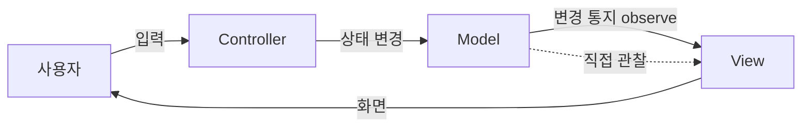
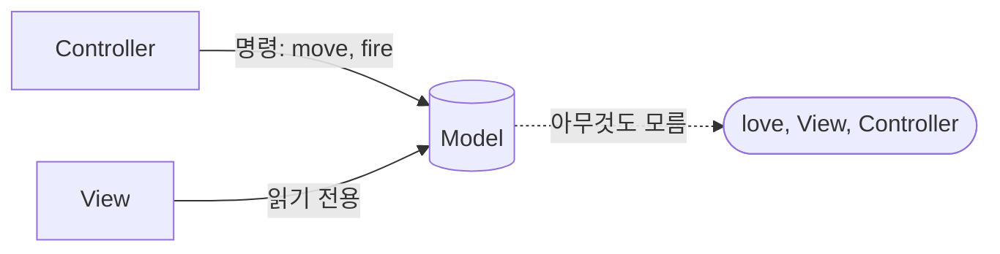

# 3주차 — [실습 2-1] 게임 MVC 재정의 & Model 분리

> **소요:** 8시간 (오전 4h 개념·설계 / 오후 4h 실습·검증)
> **선행:** 2주차(모놀리식 겔러그, 번짐 체감).
> **이번 주 한 문장:** "무엇이 Model인가"를 정확히 정의하고, 2주차 코드에서 **`love`를 전혀 모르는 순수 Model**을 뽑아낸다.

---

## ⚠️ 이 주차를 "특히 주의해서" 읽어야 하는 이유

이번 주는 **코드량보다 개념의 정확성**이 성패를 가른다. 특히 세 가지를 **혼동하면 안 된다.**

1. **"게임 MVC"는 웹 MVC와 다르다.** 용어는 같지만 데이터 흐름이 다르다.
2. **우리가 만드는 구조의 정직한 이름은 "수동 View(Passive View) / MVP 계열"이다.** 교재마다 "Game MVC"라 부르지만, 고전 MVC와는 다르다. 이 차이를 알고 써야 나중에 혼란이 없다.
3. **Model의 유일한 합격 기준은 "`love`가 한 글자도 없다"이다.** 이게 흐려지면 이번 주는 실패다.

---

## 🎯 학습 목표

1. 고전 MVC와 실시간 게임의 구조적 차이를 **설명**할 수 있다.
2. 상태(state)와 규칙(rule)을 **Model**로, 그리기/연출을 **View**로, 입력 해석을 **Controller**로 **분류**할 수 있다.
3. 2주차 모놀리식에서 `PlayerModel`/`EnemyModel`/`BulletModel`/`GameModel`을 **`love` 의존성 0으로** 추출한다.
4. Model의 데이터 구조를 **Docstring 계약**으로 서술한다.
5. **헤드리스(창 없이)** 로 Model 로직을 단위 테스트한다.

---

## ⏱ 8시간 타임테이블

| 시간 | 블록 | 내용 | 산출물 |
|------|------|------|--------|
| 1.5h | 개념 | 웹 MVC vs 게임 MVC, 정직한 명명 | 개념 노트 |
| 1.0h | 개념 | 역할 재정의 + 의존성 방향 | 다이어그램 |
| 1.5h | 설계 | 2주차 코드에서 M/V/C 식별 | 분류표 |
| 2.0h | 실습 | Model 추출(`love` 제거, 입력/연출 디커플링) | `models/*.lua` |
| 1.0h | 실습 | Docstring 계약 작성 | 주석 |
| 1.0h | 검증 | 디커플링 체크 + 헤드리스 테스트 | 테스트 통과 |

---

## 1. 웹 MVC vs 게임 MVC (개념 1.5h) — 정밀하게

### 1-1. 고전(웹/앱) MVC의 원래 의미



- **Controller**: 입력을 받아 Model을 바꾼다.
- **Model**: 데이터 + 비즈니스 규칙. 바뀌면 **스스로 "바뀌었다"고 알린다(Observer)**.
- **View**: Model을 **관찰**하다가 바뀌면 다시 그린다.
- 핵심: **이벤트/관찰 기반**이고, 입력은 **간헐적**(클릭, 폼 제출)이다.

### 1-2. 실시간 게임의 특수성

게임은 다르다.
- **매 프레임**(초당 수십~수백 회) `update`가 돈다. "변경 통지"를 기다릴 필요 없이 **매 프레임 전체를 다시 그린다.**
- 입력이 **연속적**(이번 프레임에 ← 눌림?)이다.
- `dt`(프레임 간 시간)에 따라 물리를 적분한다.

→ 그래서 게임에서는 **"Model이 바뀔 때마다 통지"하는 Observer가 과하다.** View가 **매 프레임 Model을 읽어 통째로 그리면** 된다.

### 1-3. ⚠️ 정직한 명명 — 우리가 만드는 건 "수동 View(MVP 계열)"

많은 자료가 이 구조를 "Game MVC"라 부르지만, **엄밀히는 고전 MVC가 아니다.**

| | 고전 MVC | 우리 구조 (이 과정) |
|---|---------|---------------------|
| View가 Model을 아는가 | 관찰(Observer)로 **안다** | **매 프레임 읽기만** 한다(수동) |
| Model이 View에 통지하는가 | **한다** | **안 한다** (Model은 View 존재를 모름) |
| 입력 처리 | Controller | Controller(입력 해석 전담) |
| 정확한 패턴 이름 | MVC | **Passive View ≈ MVP 계열** |

> **왜 이걸 짚나?** "Model이 View에게 알린다"는 고전 MVC의 사고를 게임에 그대로 가져오면, Model 안에 View 참조가 스며들어 **디커플링이 깨진다.** 우리는 반대로 간다: **Model은 아무에게도 알리지 않는다.** View가 알아서 읽는다.

---

## 2. 역할 재정의 & 의존성 방향 (개념 1.0h)

### 2-1. 세 계층의 "해도 되는 것 / 금지"

| 계층 | 책임(해야 함) | 절대 금지 |
|------|--------------|-----------|
| **Model** | 상태 보관, dt 기반 규칙(이동·충돌·점수·HP), 결정적 연산 | `love.*` 호출, 그리기, 사운드, 입력 직접 읽기 |
| **View** | Model 상태를 **읽어서** 그리기·사운드·연출 | 상태 변경(좌표·점수·HP 수정) |
| **Controller** | 입력(키/패드)을 **해석**해 Model에 명령 | 물리 계산, 그리기 |

### 2-2. 의존성은 한 방향 — Model은 아무도 모른다



- `Controller → Model`, `View → Model` (둘 다 Model에 의존)
- **`Model →` 아무 데도 화살표가 없다.** Model은 `love`도, View도, Controller도 모른다.
- 이 "모름"이 바로 **헤드리스 테스트·이식성·재현성**을 가능하게 한다.

### 2-3. "Model은 love를 몰라야 한다"가 주는 3가지 이득

1. **테스트:** 창 없이 `luajit`로 "총알 1,000개 충돌 시 점수"를 0.1초에 검증.
2. **이식성:** 렌더러를 바꿔도(LÖVE→다른 것) Model은 그대로.
3. **재현성:** 입력과 시드가 같으면 결과가 같다 → 버그 재현·리플레이 가능.

---

## 3. 2주차 코드에서 M/V/C 식별하기 (설계 1.5h)

2주차 `galaga_monolith/main.lua`를 열고 **한 줄씩 분류**한다.

| 2주차 코드 | 분류 | 3주차 행선지 |
|-----------|------|-------------|
| `player.x = player.x + PLAYER_SPEED*dt` | Model(규칙) | `PlayerModel:update` |
| `love.keyboard.isDown("left")` | Controller(입력) | (4주차) `InputManager` |
| `love.graphics.rectangle(...)` | View(그리기) | (4주차) `*View` |
| `explode()` 파티클/flash | View(연출) | **이벤트로 발행** → View가 소비 |
| `score = score + 100` | Model(규칙) | `GameModel` |
| `math.randomseed(os.time())` | ⚠️ 비결정 | **주입 RNG**로 교체 |

> **이번 주 범위:** 위 표의 **Model 칸만** 뽑아 `models/`로 옮긴다. View/Controller 실제 연결은 **4주차**.

---

## 4. [실습] Model 추출 (2.0h) — 세 가지 디커플링

Model을 `love`에서 떼어내려면 **세 개의 탯줄**을 끊어야 한다.

### 디커플링 ❶ — 입력 (keyboard → 주입)
모놀리식은 Model 로직 안에서 `love.keyboard.isDown`을 읽었다. 대신 **입력을 인자로 주입**한다.

```lua
-- Before (결합): Model이 love를 직접 읽음
if love.keyboard.isDown("space") then fire() end

-- After (분리): 바깥(Controller)이 해석한 결과만 받는다
function GameModel:update(dt, input)   -- input = { move = -1|0|1, fire = true|false }
  if input.fire and self.player:canFire() then ... end
end
```

### 디커플링 ❷ — 연출/사운드 (직접 호출 → 이벤트 발행)
Model은 파티클·사운드를 만들지 않는다. "무슨 일이 일어났는지"만 **이벤트 목록**에 남긴다.

```lua
-- Before (결합): 로직이 연출을 직접 생성
explode(e.x, e.y)  -- 파티클 + flash + 사운드

-- After (분리): 사실만 기록. 연출은 View가 나중에 소비.
self.events[#self.events+1] = { type = "enemy_destroyed", x = cx, y = cy }
```

### 디커플링 ❸ — 무작위 (전역 random → 주입 RNG)
`math.randomseed(os.time())`는 비결정적이라 테스트가 불가능하다. **시드를 받는 RNG**를 주입한다.

```lua
local game = GameModel{ width = 600, height = 800, seed = 42 }  -- __call 로 생성. 같은 시드 → 같은 결과
```

> 결과: `models/`의 어떤 파일에도 `love`가 없다. `GameModel:update(dt, input)`만 호출하면 **창 없이** 게임이 "머릿속에서" 돌아간다.

---

## 5. Docstring 계약 작성 (1.0h)

Lua는 동적 타입이라 **데이터 모양을 주석으로 명시**해야 AI·동료가 헷갈리지 않는다. (바이브 코딩 2원칙)

```lua
--- 입력 계약 (Controller → GameModel)
-- @field move  number  -1(왼) | 0 | 1(오)
-- @field fire  boolean  이번 프레임 발사 여부

--- 이벤트 계약 (GameModel → View)
-- { type = "fire" }
-- { type = "enemy_destroyed", x = number, y = number }
-- { type = "player_hit" }
-- { type = "formation_cleared" }
```

---

## 6. 검증 (1.0h) — 하네스 우선

### ① 디커플링 체크 (love 0건)
```sh
# models/ 안에 love. 가 있으면 실패
grep -rn "love\." lua_tuto/mvc/week03/examples/models && echo "FAIL: love 발견" || echo "OK: love 없음"
```
또는 제공된 헤드리스 스캐너:
`luajit examples/tests/decoupling_check.lua`

### ② 헤드리스 모델 테스트
`luajit examples/tests/model_test.lua`
- 발사→충돌 시 **점수 +100** & `enemy_destroyed` 이벤트 발생
- **같은 시드로 두 번 돌리면 결과 동일**(결정성)
- 이 테스트가 **창 없이** 통과한다는 사실 자체가 디커플링 성공의 증거다.

> 이번 주는 `love` 실행이 **필요 없다.** View/Controller가 아직 없기 때문. (4주차에 연결)

---

## 7. ⚠️ 흔한 실수 (반드시 확인)

| 실수 | 왜 문제인가 | 올바른 방향 |
|------|------------|-------------|
| Model에서 `love.math.random` 사용 | `love` 의존 재발 → 테스트 불가 | 주입 RNG(`self.rng`) |
| Model이 파티클 테이블을 직접 생성 | View 책임 침범 | 이벤트 발행 |
| Model에 화면 크기 `love.graphics.getWidth()` | `love` 의존 | 생성 시 `width` 주입 |
| `draw`에서 좌표/점수 수정 | 비결정·프레임 의존 | `draw`는 읽기 전용 |
| getter가 `love` 객체(Image 등) 반환 | Model이 `love` 타입을 앎 | Model은 숫자/문자열/테이블만 |
| "Model이 View에 알려준다"고 설계 | 고전 MVC 착각 → 역결합 | View가 매 프레임 읽는다(수동) |

---

## 8. 과제 & 체크리스트

### 과제
- [ ] `PlayerModel`/`EnemyModel`/`BulletModel`/`GameModel`을 `love` 0으로 추출한다.
- [ ] 입력·연출·무작위 **세 디커플링**을 모두 적용한다.
- [ ] 입력/이벤트 **Docstring 계약**을 작성한다.
- [ ] 헤드리스 테스트 2종을 통과시킨다.

### 합격 체크리스트
- [ ] `grep -rn "love\." models/` 결과가 **0건**이다.
- [ ] `luajit tests/model_test.lua`가 **창 없이** 통과한다.
- [ ] 같은 시드로 두 번 돌린 최종 점수가 **동일**하다.
- [ ] Model 어디에도 그리기/사운드/입력읽기가 없다.

---

## 📁 예제 파일 안내

```
week03/
  README.md
  examples/
    models/
      class.lua          ← 메타테이블 클래스 유틸
      rng.lua            ← 결정적 RNG(주입용, love 비의존)
      PlayerModel.lua    ← 플레이어 상태+이동 (love 0)
      EnemyModel.lua     ← 적 1기 상태 (love 0)
      BulletModel.lua    ← 투사체 1발 상태+이동 (love 0)
      GameModel.lua      ← 오케스트레이션: 충돌·점수·라이프·이벤트 (love 0)
    tests/
      model_test.lua       ← 헤드리스 단위 테스트
      decoupling_check.lua ← models/에 love 유무 스캔
```

### 실행 방법
- 디커플링 체크: `cd lua_tuto/mvc/week03/examples/tests && luajit decoupling_check.lua`
- 모델 테스트: `cd lua_tuto/mvc/week03/examples/tests && luajit model_test.lua`
- (이번 주는 `love` 실행 불필요 — View는 4주차)

> 환경에 따라 `luajit` 대신 `lua5.1`도 가능. task `Lua: Run current file`을 우선 사용한다.
