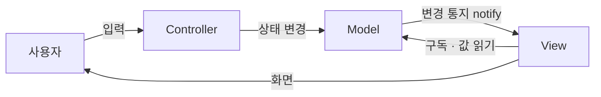
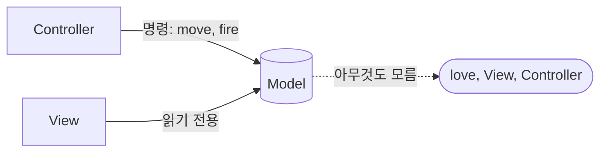

# 3주차 — [실습 2-1] 게임 MVC 재정의 & Model 분리

> **소요:** 8시간 (오전 4h 개념·설계 / 오후 4h 실습·검증)
> **선행:** 2주차(모놀리식 겔러그, 번짐 체감) + **[basics/](../basics/README.md) 사전 학습**(8시간 외, 1주차 전 완료 전제).
> **이번 주 한 문장:** "무엇이 Model인가"를 정확히 정의하고, 2주차 코드에서 **`love`를 전혀 모르는 순수 Model**을 뽑아낸다.

---

## ⚠️ 이 주차를 "특히 주의해서" 읽어야 하는 이유

이번 주는 **코드량보다 개념의 정확성**이 성패를 가른다. 특히 세 가지를 **혼동하면 안 된다.**

1. **"게임 MVC"는 웹 MVC와 갱신 방식이 다르다.** 역할 분담은 같고, "화면을 언제 다시 그리는가"만 다르다.
2. **우리 구조의 정확한 이름은 "Model이 View를 모르는 MVC + 매 프레임 읽기(Pull) 갱신"이다.** Passive View나 MVP가 **아니다.** (이전 판의 "Passive View/MVP 계열" 표기는 오류였다 — 1-3절)
3. **Model의 합격 기준은 "`print`·`io`·`love`가 한 글자도 없다"이다.** (basics 3절과 동일) 이게 흐려지면 이번 주는 실패다.

---

## 🎯 학습 목표

1. 고전 MVC와 실시간 게임의 구조적 차이를 **설명**할 수 있다.
2. 상태(state)와 규칙(rule)을 **Model**로, 그리기/연출을 **View**로, 입력 해석을 **Controller**로 **분류**할 수 있다.
3. 2주차 모놀리식에서 `PlayerModel`/`EnemyModel`/`BulletModel`/`GameModel`을 **`love` 의존성 0으로** 추출한다.
4. Model의 데이터 구조를 **Docstring 계약**으로 서술한다.
5. **헤드리스(창 없이)** 로 Model 로직을 단위 테스트한다.

---

## ⏱ 8시간 타임테이블

| 시간 | 블록 | 내용 | 산출물 |
|------|------|------|--------|
| 1.5h | 개념 | basics 복습 → 웹 MVC vs 게임 MVC, 정확한 명명 | 개념 노트 |
| 1.0h | 개념 | 역할 재정의 + 의존성 방향 | 다이어그램 |
| 1.5h | 설계 | 2주차 가설 확인(10분) → 2주차 코드에서 M/V/C 식별 | 분류표 |
| 2.0h | 실습 | `starter/` 채우기 — 테스트 FAIL 을 ok 로 (입력/연출/무작위 디커플링) | `starter/*.lua` |
| 0.5h | 실습 | Docstring 계약 정리 | 주석 |
| 0.5h | 관찰 | 헤드리스 시뮬레이터로 "창 없이 도는 게임" 보기 + 동작 보존 토론 | 관찰 메모 |
| 1.0h | 검증 | 디커플링 체크 + 헤드리스 테스트 + 개념 퀴즈 | 테스트 통과 |

---

## 1. 웹 MVC vs 게임 MVC (개념 1.5h) — 정밀하게

### 1-0. basics 복습 (20분) — 이미 본 것을 게임 언어로 바꾸기

사전 학습한 [basics/](../basics/README.md) 예제를 이번 주 개념에 대응시킨다. 새로 배우는 것은 **"시간(`dt`)이 더해진다"** 하나뿐이다.

| basics 예제 | 이미 본 것 | 이번 주 연결 |
|-------------|----------|---------------|
| 01_counter | Controller 가 Model 변경 후 `view:render(model)` 호출 (Pull) | 게임에서는 `love.draw` 가 **매 프레임** 자동으로 이 역할 |
| 03_temperature | Model 이 구독자에게 통지 (Observer, Push) | 1-1절 "고전 MVC"의 갱신 방식 |
| 04_guess_number | 난수 함수 주입 → 결과 재현 | 디커플링 ③ 주입 RNG |
| 05_grid_robot 6절 | View 만 바꿔 콘솔 → LÖVE | Model 에 `love` 가 없어야 하는 이유 |
| 06_dungeon `EventBus` | Model 간 사건 전달(즉시 호출) | 디커플링 ② `events` 목록 = **큐 버전** |
| 06_dungeon README 6절 | 턴제 vs 실시간 차이 | 바로 이번 주의 `update(dt, input)` |

> 💡 **생성자 문법 차이:** basics 는 `X.new()`, 이 과정(1·3주차)은 `class()` 유틸의 `__call` 로 `X(...)` / `X{...}` 를 쓴다. 동작은 같다(둘 다 메타테이블 + `__index`).

### 1-1. 고전(웹/앱) MVC의 원래 의미



- **Controller**: 입력을 받아 Model을 바꾼다.
- **Model**: 데이터 + 규칙. 바뀌면 **구독자 목록에 "바뀌었다"고 알린다(Observer)**. 구독자가 View 인지는 모른다.
- **View**: Model을 **구독**하고, 통지를 받으면 Model 값을 읽어 다시 그린다.
- 핵심: **변경이 있을 때만** 다시 그린다. 입력은 **간헐적**(클릭, 폼 제출)이다.
- basics 예제 3(`temperature_model.lua`)이 정확히 이 방식이다. Model 은 함수 목록만 갖고 View 를 `require` 하지 않는다.

### 1-2. 실시간 게임의 특수성

게임은 다르다.
- **매 프레임**(초당 수십~수백 회) `update`가 돈다. "변경 통지"를 기다릴 필요 없이 **매 프레임 전체를 다시 그린다.**
- 입력이 **연속적**(이번 프레임에 ← 눌림?)이다.
- `dt`(프레임 간 시간)에 따라 물리를 적분한다.

→ 그래서 게임에서는 **통지 없이 View가 매 프레임 Model을 읽어 통째로 그리는 방식(Pull)**이 더 단순하다. 어차피 매 프레임 다시 그리므로 "바뀌었는지" 알릴 필요가 없다.

> Observer 가 **틀린 것은 아니다.** 점수판·업적 팝업처럼 "가끔 바뀌는 UI"나 Model 끼리의 연동(basics 06 `EventBus`)에는 게임에서도 자주 쓴다. 다만 "매 프레임 전부 다시 그리는 화면"에는 필요 없는 장치다.

### 1-3. ⚠️ 정확한 명명 — 우리 구조는 "Pull 갱신 MVC"다

고전 MVC 와 우리 구조는 **역할 분담과 의존성 방향이 같다.** 다른 것은 **갱신을 무엇이 일으키는가** 하나다.

| | 고전 MVC (Push) | 우리 구조 (Pull) |
|---|---------|---------------------|
| View가 Model을 아는가 | **안다** (구독 + 읽기) | **안다** (매 프레임 읽기) |
| Model이 View를 아는가 | **모른다** (구독자 함수 목록만) | **모른다** (통지도 안 함) |
| 다시 그리는 계기 | Model의 변경 통지 | `love.draw` (매 프레임) |
| 입력 처리 | Controller | Controller |

**왜 Passive View / MVP 가 아닌가?** (이전 판 표기 정정)

| 패턴 | 정의 | 우리 구조와 다른 점 |
|------|------|--------------------|
| **Passive View** (Fowler) | View 는 Model 을 **전혀 모른다.** Presenter 가 View 에 값을 넣어 준다(`view:setScore(10)`) | 우리 View 는 Model 을 **직접 읽는다** |
| **MVP** | View ↔ Presenter 가 인터페이스로 양방향 연결, Presenter 가 표시 로직 담당 | 우리에겐 Presenter 가 없다. Controller 는 입력만 해석한다 |

> **왜 이걸 짚나?** 이름이 틀리면 설계가 틀어진다. "Passive View"라고 믿으면 View 에 값을 밀어 넣는 Presenter 를 만들게 되고, "Observer 는 나쁘다"고 믿으면 basics 03 의 올바른 설계를 틀렸다고 오해한다.
> 불변의 핵심은 하나다: **Model 은 View 를 모른다.** Push 든 Pull 이든 이것만 지키면 디커플링은 깨지지 않는다.

---

## 2. 역할 재정의 & 의존성 방향 (개념 1.0h)

### 2-1. 세 계층의 "해도 되는 것 / 금지"

| 계층 | 책임(해야 함) | 절대 금지 |
|------|--------------|-----------|
| **Model** | 상태 보관, dt 기반 규칙(이동·충돌·점수·HP), 결정적 연산 | `love.*`·`print`·`io.*` 호출, 그리기, 사운드, 입력 직접 읽기 |
| **View** | Model 상태를 **읽어서** 그리기·사운드·연출 | 상태 변경(좌표·점수·HP 수정) |
| **Controller** | 입력(키/패드)을 **해석**해 Model에 명령 | 물리 계산, 그리기 |

### 2-2. 의존성은 한 방향 — Model은 아무도 모른다



- `Controller → Model`, `View → Model` (둘 다 Model에 의존)
- **`Model →` 아무 데도 화살표가 없다.** Model은 `love`도, View도, Controller도 모른다.
- 이 "모름"이 바로 **헤드리스 테스트·이식성·재현성**을 가능하게 한다.

### 2-3. "Model은 love를 몰라야 한다"가 주는 3가지 이득

1. **테스트:** 창 없이 `luajit`로 "총알 1,000개 충돌 시 점수"를 0.1초에 검증.
2. **이식성:** 렌더러를 바꿔도(LÖVE→다른 것) Model은 그대로.
3. **재현성:** 입력과 시드가 같으면 결과가 같다 → 버그 재현·리플레이 가능.

---

## 3. 2주차 코드에서 M/V/C 식별하기 (설계 1.5h)

### 3-0. 가설 확인 (10분)
2주차 `monolith_pain.md` **6절(다음 주 가설)**을 펼친다. 아래 분류표를 만든 뒤 다시 비교한다.
- 내가 Model 로 빼자고 한 것 중 **맞은 것 / 빠뜨린 것 / 잘못 넣은 것**은?
- 가장 흔한 누락: `math.randomseed(os.time())`(무작위도 의존성이다), `screenShake`(연출 상태는 View 다).

### 3-1. 분류표

2주차 `galaga_monolith/main.lua`를 열고 **한 줄씩 분류**한다.

| 2주차 코드 | 분류 | 3주차 행선지 |
|-----------|------|-------------|
| `player.x = player.x + PLAYER_SPEED*dt` | Model(규칙) | `PlayerModel:move` |
| `love.keyboard.isDown("left")` | Controller(입력) | (4주차) `InputManager` |
| `love.graphics.rectangle(...)` | View(그리기) | (4주차) `*View` |
| `explode()` 파티클/flash | View(연출) | **이벤트로 발행** → View가 소비 |
| `score = score + 100` | Model(규칙) | `GameModel` |
| `math.randomseed(os.time())` | ⚠️ 비결정 | **주입 RNG**로 교체 |

> **이번 주 범위:** 위 표의 **Model 칸만** 뽑아 `models/`로 옮긴다. View/Controller 실제 연결은 **4주차**.

---

## 4. [실습] Model 추출 (2.0h) — 세 가지 디커플링

### 4-0. 실습 방식 — starter 를 채우며 테스트를 통과시킨다

`examples/starter/` 에는 **시그니처·Docstring·상수만 있고 본문은 `-- TODO`** 인 Model 이 있다. (`class.lua`, `rng.lua`, `EnemyModel.lua` 는 완성본 그대로 제공)

```sh
cd lua_tuto/mvc/week03/examples/tests
luajit model_test.lua starter        # 처음: 통과 0 / 실패 14 — 이게 정상이다
luajit decoupling_check.lua starter  # 언제나 OK 여야 한다
```

- 추천 순서: `PlayerModel` → `BulletModel` → `GameModel:spawnFormation` → `update` TODO 1~4 → `_resolveCollisions` → `drainEvents` → 편대/적 발사 → 재생성.
- 테스트는 모두 `GameModel` 을 통해 돈다. 그래서 **`PlayerModel`·`BulletModel` 만 채워서는 숫자가 오르지 않는다** — `GameModel` 에서 불러 주는 순간부터 하나씩 `ok` 로 바뀐다. 막히면 `models/` 완성본과 **해당 함수만** 대조한다.
- 원본은 2주차 `galaga_monolith/main.lua` 의 `love.update` 블록들이다. **옮기면서 `love.*` 를 어떻게 없애는가**가 아래 세 디커플링이다.

Model을 `love`에서 떼어내려면 **세 개의 탯줄**을 끊어야 한다.

### 디커플링 ❶ — 입력 (keyboard → 주입)
모놀리식은 Model 로직 안에서 `love.keyboard.isDown`을 읽었다. 대신 **입력을 인자로 주입**한다.

```lua
-- Before (결합): Model이 love를 직접 읽음
if love.keyboard.isDown("space") then fire() end

-- After (분리): 바깥(Controller)이 해석한 결과만 받는다
function GameModel:update(dt, input)   -- input = { move = -1|0|1, fire = true|false }
  if input.fire and self.player:canFire() then ... end
end
```

### 디커플링 ❷ — 연출/사운드 (직접 호출 → 이벤트 발행)
Model은 파티클·사운드를 만들지 않는다. "무슨 일이 일어났는지"만 **이벤트 목록**에 남긴다.

```lua
-- Before (결합): 로직이 연출을 직접 생성
explode(e.x, e.y)  -- 파티클 + flash + 사운드

-- After (분리): 사실만 기록. 연출은 View가 나중에 소비.
self.events[#self.events+1] = { type = "enemy_destroyed", x = cx, y = cy }
```

**⚠️ 이벤트는 "소비하는 쪽"이 비운다.** 1주차의 고정 타임스텝을 쓰면 한 프레임에 `update` 가 2번 이상 돌 수 있다. `update` 시작에서 `events` 를 비우면 앞 스텝의 "적 파괴"가 View 에 닿기 전에 사라진다(폭발 연출 누락).

```lua
-- 프레임 흐름 (4주차에서 연결)
while acc >= FIXED_DT do game:update(FIXED_DT, input); acc = acc - FIXED_DT end
for _, ev in ipairs(game:drainEvents()) do view:onEvent(ev) end   -- 프레임당 1회, 여기서 비움
```

> 이 `events` 목록은 basics 06 `EventBus` 의 **큐 버전**이다. EventBus 는 `emit` 즉시 핸들러를 부르고, 우리는 쌓아 두었다가 프레임 끝에 한 번에 넘긴다. Model 은 여전히 누가 받는지 모른다.

### 디커플링 ❸ — 무작위 (전역 random → 주입 RNG)
`math.randomseed(os.time())`는 비결정적이라 테스트가 불가능하다. **시드를 받는 RNG**를 주입한다.

```lua
local game = GameModel{ width = 600, height = 800, seed = 42 }  -- __call 로 생성. 같은 시드 → 같은 결과
```

> 결과: `models/`의 어떤 파일에도 `love`가 없다. `GameModel:update(dt, input)`만 호출하면 **창 없이** 게임이 "머릿속에서" 돌아간다.

---

## 5. Docstring 계약 정리 (0.5h)

Lua는 동적 타입이라 **데이터 모양을 주석으로 명시**해야 AI·동료가 헷갈리지 않는다. (바이브 코딩 2원칙) starter 에 이미 뼈대가 있으므로, 내가 바꾼/추가한 필드와 이벤트가 주석과 일치하는지 맞춘다.

```lua
--- 입력 계약 (Controller → GameModel)
-- @field move  number  -1(왼) | 0 | 1(오)
-- @field fire  boolean  이번 프레임 발사 여부

--- 이벤트 계약 (GameModel → View, drainEvents() 로 수령)
-- { type = "fire" }
-- { type = "enemy_destroyed", x = number, y = number }
-- { type = "player_hit" }
-- { type = "game_over" }
-- { type = "formation_cleared" }
```

---

## 5½. 창 없이 도는 게임 보기 + 동작 보존 토론 (관찰 0.5h)

### 시뮬레이터
View 는 4주차에 붙지만, Model 은 **지금 이미 게임을 돌릴 수 있다.** 자동 조종(가장 가까운 적 아래로 + 계속 발사)이 Controller 대신 입력을 넣는다.

```sh
luajit simulate.lua               # seed 42, 30초 (models/)
luajit simulate.lua 7 60          # seed 7, 60초
luajit simulate.lua 42 30 starter # 내가 채운 starter/ 로
```
```
 t(s) | score | lives | enemies | 이번 1초 이벤트
    1 |   100 |     3 |      31 | enemy_destroyed×1
    3 |   700 |     3 |      25 | enemy_destroyed×4
   10 |  1900 |     2 |      13 | player_hit×1
...
[결과] score=3000 lives=0 state=gameover  (총 파괴 30, 피격 시각: 10s, 16s, 29s)
```

관찰 과제:
1. 같은 seed 로 두 번 → `[결과]` 줄이 완전히 같은가? (결정성)
2. seed 를 바꾸면 무엇이 달라지는가? (적이 쏘는 순서 → 피격 시각)
3. 어느 seed 든 30초 전후로 끝난다. 왜일까? (힌트: 편대 하강) — **이런 밸런스 관찰을 창 없이 1초 만에** 할 수 있다는 것이 Model 분리의 실익이다.

### 동작 보존 — "리팩터링은 동작을 바꾸지 않는다"?
리팩터링의 정의는 **"구조는 바꾸되 동작은 유지"**다. 그런데 이번 추출에는 작은 차이가 있다.

| | 모놀리식(2주차) | Model(3주차) |
|---|---|---|
| 첫 적 발사 시점 | 시작 직후 (`enemyShootTimer = 0`) | 0.6초 뒤 (`ENEMY_FIRE_INTERVAL`) |
| 총알 화면 밖 판정 | 위/아래만 | 네 방향 |
| 난수 | `math.random` (매번 다름) | 주입 RNG (시드로 고정) |

토론 질문:
- 이 차이를 **자동으로** 발견할 수 있었는가? → 모놀리식은 난수가 고정되지 않고 `love` 없이 실행되지 않아, **리팩터링 전후를 비교하는 테스트(특성 테스트)를 쓸 수조차 없었다.**
- 이제는 다르다. 다음 리팩터링부터는 `simulate.lua` 의 `[결과]` 줄을 **기준값으로 저장해 두고** 전후를 비교할 수 있다. 이것이 디커플링 ③(결정성)의 진짜 이득이다.

---

## 6. 검증 (1.0h) — 하네스 우선

### ① 디커플링 체크 (print/io/love 0건)
```sh
# models/ 안에 love. / print( / io. 가 있으면 실패
grep -rnE "love\.|print\(|io\." lua_tuto/mvc/week03/examples/models && echo "FAIL" || echo "OK"
```
또는 제공된 헤드리스 스캐너(주석 제외, 식별자 경계 검사 — `ratio` 의 `io` 는 무시):
`luajit examples/tests/decoupling_check.lua`

### ② 헤드리스 모델 테스트
`luajit examples/tests/model_test.lua` (14개, 내 코드는 뒤에 `starter` 인자)
- 생성·이동·경계·발사·쿨다운
- 발사→충돌 시 **점수 +100** & `enemy_destroyed`, 피격·게임오버 이벤트
- **한 프레임 2스텝**에도 이벤트가 보존되고, `drainEvents()` 후 비워짐
- 전멸 시 편대 재생성
- **총알 1,000발** 동시 충돌 시 점수·파괴 수가 정확 (2-3절 주장의 근거)
- **같은 시드로 두 번 돌리면 결과 동일**(결정성)
- 이 테스트가 **창 없이** 통과한다는 사실 자체가 디커플링 성공의 증거다.

### ③ 개념 퀴즈 (15분, 구두 또는 짧은 서술)
1. 고전 MVC(Push) 와 우리 구조(Pull)에서 **같은 것** 두 가지와 **다른 것** 한 가지는?
2. 우리 구조를 Passive View 라고 부르면 안 되는 이유는?
3. `drainEvents()` 를 `update` 안에서 부르면(또는 `update` 시작에 `events` 를 비우면) 어떤 버그가 생기는가?
4. Model 에 `love` 뿐 아니라 `print` 도 금지인 이유는?
5. basics 03 의 Observer(Model 이 구독자에게 통지)는 디커플링을 깨는가? 왜 그런가?

> 정답과 채점 포인트는 [강사노트.md](강사노트.md) 참고.

> 이번 주는 `love` 실행이 **필요 없다.** View/Controller가 아직 없기 때문. (4주차에 연결)

---

## 7. ⚠️ 흔한 실수 (반드시 확인)

| 실수 | 왜 문제인가 | 올바른 방향 |
|------|------------|-------------|
| Model에서 `love.math.random` 사용 | `love` 의존 재발 → 테스트 불가 | 주입 RNG(`self.rng`) |
| Model이 파티클 테이블을 직접 생성 | View 책임 침범 | 이벤트 발행 |
| Model에 화면 크기 `love.graphics.getWidth()` | `love` 의존 | 생성 시 `width` 주입 |
| `draw`에서 좌표/점수 수정 | 비결정·프레임 의존 | `draw`는 읽기 전용 |
| getter가 `love` 객체(Image 등) 반환 | Model이 `love` 타입을 앎 | Model은 숫자/문자열/테이블만 |
| Model이 구체적인 View 를 `require` 하고 직접 호출 | Model → View 역결합 (Observer 자체가 문제가 아님) | 구독자 함수 목록(basics 03) 또는 이벤트 목록 |
| `update` 시작에서 `events = {}` 로 비움 | 한 프레임 다중 스텝 시 이벤트 소실 | 소비자가 `drainEvents()` 로 프레임당 1회 비움 |
| Model 에서 디버그용 `print` | 콘솔에 묶임, 테스트 출력 오염 | 테스트에서 상태를 읽어 확인 |

### 다음 주로 넘기는 것 (알고만 있을 것)
- **View 의 "읽기 전용"은 지금은 약속일 뿐이다.** View 가 `game.bullets` 를 직접 읽으므로 실수로 바꿔도 막을 장치가 없다. 지키는 방법은 ① 읽기 전용 프록시(`__newindex` 에서 에러) ② getter 만 노출 ③ 테스트로 검사(basics `dungeon_test` 의 "View 가 Model 을 바꾸지 않는지") — 4주차에서 ③을 쓴다.
- **성능은 아직 신경 쓰지 않는다.** `GameModel` 은 루프 안 `table.remove`, 적 발사마다 `alive = {}`, 발사마다 `BulletModel` 생성으로 할당이 있다. 1주차 GC 원칙과 어긋나지만, **구조를 먼저 바로잡고 측정한 뒤 최적화**한다 → 7주차 프로파일링 소재.

---

## 8. 과제 & 체크리스트

### 과제
- [ ] `starter/` 의 `PlayerModel`/`BulletModel`/`GameModel` TODO 를 모두 채운다 (`print`·`io`·`love` 0).
- [ ] 입력·연출·무작위 **세 디커플링**을 모두 적용한다.
- [ ] 입력/이벤트 **Docstring 계약**을 내 코드와 일치시킨다.
- [ ] `simulate.lua ... starter` 로 내 Model 을 30초 돌려 보고, 완성본과 `[결과]` 줄을 비교한다.

### 합격 체크리스트
- [ ] `luajit decoupling_check.lua starter` 결과가 **OK(print/io/love 0건)**이다.
- [ ] `luajit model_test.lua starter` 가 **창 없이 14/14** 통과한다.
- [ ] 같은 시드로 두 번 돌린 최종 점수가 **동일**하다.
- [ ] 한 프레임에 스텝이 여러 번 돌아도 이벤트가 사라지지 않는다.
- [ ] 우리 구조를 "Passive View"가 아닌 **"Pull 갱신 MVC"**로 설명할 수 있다.
- [ ] Model 어디에도 그리기/사운드/입력읽기가 없다.

---

## 📁 예제 파일 안내

```
week03/
  README.md
  강사노트.md            ← 운영 팁·예상 질문·퀴즈 정답 (강사용)
  examples/
    starter/             ← 실습용 스켈레톤 (본문 TODO). 학생이 채운다
      class.lua, rng.lua, EnemyModel.lua  ← 완성본과 동일(제공)
      PlayerModel.lua, BulletModel.lua, GameModel.lua  ← TODO
    models/              ← 완성본 (막혔을 때 해당 함수만 대조)
      class.lua          ← 메타테이블 클래스 유틸
      rng.lua            ← 결정적 RNG(주입용, love 비의존)
      PlayerModel.lua    ← 플레이어 상태+이동 (love 0)
      EnemyModel.lua     ← 적 1기 상태 (love 0)
      BulletModel.lua    ← 투사체 1발 상태+이동 (love 0)
      GameModel.lua      ← 오케스트레이션: 충돌·점수·라이프·이벤트(drainEvents) (love 0)
    tests/
      model_test.lua       ← 헤드리스 단위 테스트 14개 (인자: models | starter)
      decoupling_check.lua ← print/io/love 유무 스캔 (인자: models | starter)
      simulate.lua         ← 창 없이 N초 자동 플레이 출력 (인자: seed 초 대상)
```

### 실행 방법 (모두 `examples/tests/` 에서)
- 내 코드 검사: `luajit model_test.lua starter` / `luajit decoupling_check.lua starter`
- 완성본 검사: `luajit model_test.lua` / `luajit decoupling_check.lua`
- 시뮬레이터: `luajit simulate.lua 42 30` (내 코드는 `luajit simulate.lua 42 30 starter`)
- (이번 주는 `love` 실행 불필요 — View는 4주차)

> 환경에 따라 `luajit` 대신 `lua5.1`도 가능. task `Lua: Run current file`을 우선 사용한다.
