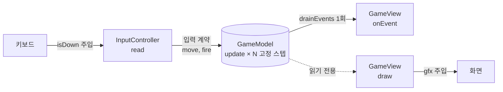

# 4주차 — [실습 2-2] 겔러그 MVC: View/Controller 연결 + 헤드리스 검증 + 번짐 실측

> **소요:** 8시간 (오전 개념·설계·실습 / 오후 기능 추가·비교·회고)
> **선행:** 3주차(순수 Model, `drainEvents`, 결정성) + 2주차 `monolith_pain.md`(T1·T2 측정값).
> **이번 주 한 문장:** 3주차 Model 을 **한 글자도 고치지 않고** View·Controller 를 붙여 게임을 완성하고, 2주차와 **같은 기능**을 추가해 번짐을 **숫자로** 비교한다.

---

## 🔗 지난주들과의 약속 (이번 주에 회수한다)

| 약속 | 어디서 | 이번 주 확인 방법 |
|------|--------|------------------|
| Model 은 View/Controller 없이 완성돼 있다 | 3주차 | `galaga_mvc/models/` = 3주차 `models/` 와 **바이트 단위 동일** (`diff -r` 결과 없음) |
| 이벤트는 프레임당 1회 `drainEvents()` | 3주차 4절 | `main.lua` 프레임 순서 + `integration_test` "한 프레임 여러 스텝" |
| View 를 붙여도 Model 결과는 같다 | 3주차 5½ | `integration_test` "View 를 붙여도 Model 결과는 같다" |
| View 는 Model 을 읽기만 한다 | 3주차 7절 | `view_test` 스냅숏 비교(테스트로 검사) |
| 같은 기능을 MVC 에 추가하면 번짐이 어떤가 | 2주차 3절 | 7절 실측 표 |
| 같은 프롬프트 P 로 AI 측정 T3 | 2주차 1-4 | 8절 |

---

## 🎯 학습 목표

1. View 가 `love.graphics` 를 **주입받아** 그리게 하고, 그 덕분에 **창 없이 View 를 테스트**할 수 있다.
2. Controller 가 `love.keyboard.isDown` 을 **주입받아** 입력 계약 `{ move, fire }` 를 만들게 한다.
3. `main.lua` 를 **조립부(composition root)** 로만 쓰고, 한 프레임의 순서(C → M 고정 스텝 → 이벤트 → V)를 설명할 수 있다.
4. 2주차와 같은 기능(유도 미사일·보스)을 추가하고 **수정 범위를 실측**해 모놀리식과 비교한다.
5. MVC 가 **해결한 것과 해결하지 못한 것**을 정직하게 말할 수 있다.

---

## ⏱ 8시간 타임테이블

| 시간 | 블록 | 내용 | 산출물 |
|------|------|------|--------|
| 1.0h | 개념 | View·Controller 의 책임, **의존성 주입**(gfx·isDown), 조립부 | 개념 노트 |
| 0.5h | 설계 | 폴더·require 경로, 한 프레임 순서도 | 순서도 |
| 2.0h | 실습 | `starter/` 의 View·Controller TODO 채우기 → 테스트 통과 | `starter/views`, `controllers` |
| 0.5h | 실습 | `starter/main.lua` 프레임 루프 → **실행 확인 1회** | 동작하는 게임 |
| 1.5h | 실습 | 2주차와 같은 기능 1개 추가(유도 미사일 **또는** 보스) + 테스트 | 기능 + 테스트 |
| 1.0h | 비교 | 번짐 실측(diff) + AI 측정 T3 → 2주차 기록과 대조 | 비교표 |
| 1.5h | 회고 | 4항목 루브릭 채점 + 개념 퀴즈 | 루브릭 |

---

## 1. View 와 Controller 의 책임 (개념 1.0h)

### 1-1. 한 프레임의 흐름



> 이 그림의 화살표는 **데이터 흐름**이다. 3주차 2-2절의 화살표(**누가 누구를 아는가**)와 다르다. 의존성으로 보면 여전히 C → M, V → M 이고 **M 에서 나가는 화살표는 없다.** (`drainEvents` 도 main 이 Model 에게서 *꺼내 가는* 것이다)

```lua
-- main.lua 의 love.update 순서 (이 순서가 이번 주 핵심)
local input = controller:read()                 -- 1) C: 프레임당 1회
acc = acc + dt
while acc >= FIXED_DT do                         -- 2) M: 0~N 번
  game:update(FIXED_DT, input)
  acc = acc - FIXED_DT
end
for _, ev in ipairs(game:drainEvents()) do      -- 3) M→V: 반복문 "밖"에서 1회
  view:onEvent(ev)
end
view:update(dt)                                  -- 4) V: 연출 시간 진행
```

> ⚠️ **고정 타임스텝의 한계 (정직하게):** 입력은 **프레임마다 한 번** 읽는다. 그래서 키를 누르고 떼는 순간이 프레임 경계로 반올림된다. 60fps 는 1/60초, 20fps 는 3/60초 단위다.
> - **입력이 일정하면** 프레임률과 무관하게 결과가 같다 (`integration_test` 1번).
> - **입력이 바뀌면** 같은 시간에 키를 떼도 60fps 와 20fps 의 결과가 다를 수 있다. 0.31초에 → 를 떼면 x = 381.3 vs 392.0 이다 (`integration_test` ‘[한계]’).
> - 고정 타임스텝이 보장하는 것은 **"같은 스텝에 같은 입력이면 같은 결과"**다. 프레임률과 완전히 무관한 결과까지 보장하지는 않는다.
> - 완전한 재현(리플레이)을 원하면 **스텝마다 쓴 입력을 기록**해 두었다가 그대로 다시 넣는다 → 6주차에서 다룬다. 다만 기록은 **이미 일어난 판을 그대로 다시 보여 주는 것**이다. 사람이 칠 때 입력이 프레임 경계로 반올림되는 현상 자체는 없애지 못한다. LÖVE 는 키 이벤트에 정밀한 시각을 주지 않는다.

### 1-2. 의존성 주입 — "love 를 직접 부르지 않는다"

| | 직접 부르면 | 주입받으면 (이번 주) |
|---|---|---|
| View | `love.graphics.rectangle(...)` | `GameView:draw(gfx, game)` → `gfx.rectangle(...)` |
| Controller | `love.keyboard.isDown("left")` | `InputController(game, isDown)` → `self.isDown("left")` |
| 테스트 | 창이 있어야 실행 가능 | **가짜 gfx / 가짜 isDown** 을 넣어 창 없이 실행 |

> 실제 게임에서는 `main.lua` 가 진짜 `love.graphics`, `love.keyboard.isDown` 을 넣어 준다. **`love` 를 아는 파일은 `main.lua` 하나**로 줄어든다. (basics 06 의 "모두를 아는 파일은 main 하나" 원칙과 같다)

### 1-3. View 의 규칙
- **Model 은 읽기만.** `game.score = ...` 같은 쓰기는 금지. 이번 주부터는 **테스트가 잡아낸다**(6절).
- **연출 상태는 View 의 것이다.** 파티클·번쩍임·흔들림 타이머는 `EffectsView` 가 갖는다. 2주차에서 Model 에 섞여 있던 바로 그것들이다.
- **연출용 난수는 View 에 있어도 된다.** 파티클 방향이 매번 달라도 게임 규칙(점수·생존)은 바뀌지 않는다. **결정성은 Model 의 약속**이다.
- **draw 는 그리기만.** 흔들림 오프셋 같은 계산도 `update(dt)` 에서 해 두고 `draw` 는 읽는다(1주차 규칙).
- **모르는 이벤트는 무시한다.** Model 이 이벤트 종류를 늘려도 View 가 깨지지 않는다(6절에서 효과를 본다).

### 1-4. Controller 의 규칙
- **연속 입력**(누르고 있는 키) → `read()` 가 매 프레임 입력 계약을 만든다.
- **단발 입력**(눌린 순간) → `keypressed(key)` 가 Model 명령(`game:reset()`)이나 **앱 명령**(`"quit"`)을 돌려준다.
- **앱 종료는 Controller 가 하지 않는다.** `"quit"` 을 돌려주면 `main` 이 `love.event.quit()` 을 부른다. Controller 가 `love.event` 를 알면 테스트할 수 없다.
- **키 배치는 Controller 의 책임.** `A/D` 를 추가해도 Model·View 는 모른다.
- **`read()` 는 같은 테이블을 재사용해 돌려준다**(프레임마다 할당하지 않기 위해). 그래서 받은 쪽이 `input` 을 **보관하면 안 된다.** 다음 프레임에 값이 바뀐다. 기록하려면 값을 복사한다. 6주차 입력 기록에서 중요해진다.

### 1-5. 조립부(main.lua)의 규칙
- M·V·C 를 **만들고 연결만** 한다. 규칙·문구·키 해석 없음.
- **비결정 요소는 여기서만.** `seed = os.time()` 은 조립부가 정한다. Model 은 받은 시드대로 결정적으로 돈다.
- **`love.filesystem.setRequirePath`** 로 `models/`·`views/`·`controllers/` 를 경로에 등록한다. 덕분에 3주차 Model 의 `require("class")` 를 **고치지 않아도** 된다.
- **`MAX_FRAME_DT`**: 창을 끌거나 디버거로 멈추면 `dt` 가 몇 초가 된다. 그대로 두면 고정 스텝을 수백 번 돌려 다음 프레임이 더 느려지는 악순환(spiral of death)이 생긴다. 0.25초로 자른다.

---

## 2. 설계 — 폴더와 경로 (0.5h)

```
galaga_mvc/
  main.lua           ← 조립부 (love 를 아는 유일한 파일)
  conf.lua
  models/            ← 3주차 그대로 (print/io/love 0)
  views/             ← love 금지(주입받은 gfx 만), Controller require 금지
  controllers/       ← love 금지(주입받은 isDown 만), View require 금지
```

계층 규칙은 `tests/layer_check.lua` 가 정적으로 검사한다.

---

## 3. [실습] starter 채우기 (2.0h + 0.5h)

`examples/starter/` 는 **Model 은 완성본(3주차)**, View·Controller 는 **본문이 TODO** 다.

| 파일 | 상태 |
|------|------|
| `models/*` | 완성 (3주차와 동일) |
| `views/PlayerView.lua` | **완성 예시** — 이걸 보고 나머지를 쓴다 |
| `views/EnemyView.lua`, `BulletView.lua`, `HudView.lua` | TODO |
| `views/EffectsView.lua` | `onEvent` 만 TODO (파티클 물리 등은 제공) |
| `views/GameView.lua` | `draw` 만 TODO (그리는 순서) |
| `controllers/InputController.lua` | `read`, `keypressed` TODO |
| `main.lua` | `love.update` 만 TODO (프레임 순서) |

```sh
cd lua_tuto/mvc/week04/examples/tests
luajit layer_check.lua starter        # 항상 OK 여야 한다
luajit controller_test.lua starter    # 처음: 통과 3 / 실패 6
luajit view_test.lua starter          # 처음: 통과 4 / 실패 5
luajit integration_test.lua starter   # 처음: 통과 1 / 실패 4
```

> 🤔 **빈 코드인데 왜 몇 개는 통과하나?** "draw 는 Model 을 바꾸지 않는다" 같은 **금지 규칙** 테스트는 아무것도 안 하는 코드도 통과한다. 그래서 금지 테스트는 반드시 **기능 테스트**("적 수만큼 그린다")와 짝을 이뤄야 의미가 있다. 테스트를 설계할 때 기억할 점.

- `main.lua` 는 테스트가 직접 검사하지 않는다(`integration_test` 는 같은 순서를 **흉내** 낸다). 그래서 마지막에 **한 번 실행**해 확인한다: `love lua_tuto/mvc/week04/examples/starter`
- 막히면 `galaga_mvc/` 완성본의 **해당 함수만** 대조한다.

---

## 4. 테스트 기법 — 창 없이 View·Controller 검사하기

| 기법 | 어디서 | 무엇을 잡나 |
|------|--------|------------|
| **가짜 gfx (호출 기록기)** | `helper.fakeGfx()` | 무엇을 몇 번 그렸나 (`rectangle` 개수, `print` 내용, `push`/`pop` 짝) |
| **스냅숏 비교** | `helper.snapshot/same` | draw·onEvent·update 전후로 Model 이 **한 글자라도 바뀌면** 실패하고 바뀐 경로를 알려 준다 (`game.score`) |
| **가짜 isDown** | `controller_test` | 키 조합 → 입력 계약 |
| **프레임 루프 재현** | `integration_test` | 입력이 일정할 때 60fps vs 20fps 결과 동일, 한 프레임 다중 스텝에서도 연출 도착, **[한계] 입력이 바뀌면 결과가 달라짐(특성 테스트)** |
| **특성(characterization) 테스트** | `integration_test` [한계] | "지금 이렇게 동작한다"를 고정한다. 입력 처리 방식이 바뀌면 이 테스트가 알려 준다. (6주차 입력 기록은 이 한계를 고치지 않으므로 계속 통과한다 — 6주차 README 참고) |
| **정적 계층 검사** | `layer_check` | 폴더별 금지 API·금지 require |

> 가짜 gfx 는 basics 의 **가짜 View(spy)** 와 같은 아이디어다. "진짜 대신 호출만 기록하는 대역"을 넣으면 화면 없이도 "무엇을 하려 했는지"를 검사할 수 있다.

> ✅ 이 테스트들이 **실제로 버그를 잡는지** 확인했다: HUD 가 점수를 바꾸게 고치면 `view_test` 가 `game.score` 를 지목하고, View 에 `love.graphics` 나 Controller 에 `love.event` 를 넣으면 `layer_check` 가, 3주차 이벤트 소실 버그를 되살리면 `integration_test` 가 실패한다.

---

## 5. [실습] 같은 기능 추가 (1.5h)

2주차와 **같은 기능**을 고른다: **유도 미사일(X 키)** 또는 **보스 원형 탄막**. 완성 예시는 `galaga_mvc_full/` (둘 다 추가).

**추가 전에 먼저 예측한다:** "어느 계층의 어느 파일을 고치게 될까?" → 종이에 적고 시작.

추천 방법 (완성 예시가 택한 방식):
- **유도:** 새 파일 `models/homing.lua` (상태 없는 순수 함수) + 미사일은 기존 `BulletModel` 을 `kind = "missile"` 로 재사용
- **보스:** 새 파일 `models/BossModel.lua` (이동·탄막·피해) + `views/BossView.lua`
- **테스트 먼저:** `feature_test.lua` 처럼 "미사일은 휘지만 **일반 총알은 휘지 않는다**" 같은 **번짐 방지 테스트**를 넣는다.

---

## 6. 번짐 실측 — 2주차 vs 4주차 (비교 1.0h)

같은 두 기능(유도 미사일 + 보스 탄막)을 추가했을 때의 **실측값**이다.

```sh
# 2주차
diff week02/examples/galaga_monolith/main.lua week02/examples/galaga_monolith_full/main.lua | grep -cE '^[0-9]'
# 4주차
cd week04/examples && diff -r galaga_mvc galaga_mvc_full | grep -cE '^[0-9]'
```

| 지표 | 2주차 모놀리식 | 4주차 MVC |
|------|---------------|-----------|
| 수정한 기존 파일 | 1개 (`main.lua` 전체) | 8개 (그중 3개는 주석·창 제목만) |
| 새 파일 | 0 | 3개 (`BossModel` 69줄, `homing` 39줄, `BossView` 21줄) |
| 변경 블록(hunk) | **41** (한 파일 안 전역) | **25** (GameModel 12 · InputController 5 · BulletView 2 · GameView 2 · HudView 1 · 기타 3) |
| 추가·삭제된 줄 | +176 / −38 | 기존 파일 +107 / −10 · 새 파일 +129 |
| **전혀 안 건드린 것** | 없음 | `PlayerModel`, `EnemyModel`, `EffectsView`, `PlayerView`, `EnemyView` |
| 기존 테스트 | 없음 | 기존 23개(controller 9·view 9·integration 5) + 3주차 모델 테스트 14개 **전부 그대로 통과** (회귀 없음) |
| 새 기능 테스트 | 불가 | `feature_test` 14개 |

### 정직한 해석
- ✅ **해결된 것**
  - **무관한 코드로의 번짐이 사라졌다.** 2주차 `[B5]` 는 보스 탄막 때문에 *일반 적 총알* 생성·이동 코드까지 바꿨다. 4주차는 `BulletModel` 이 처음부터 `vx/vy` 를 가져서 **총알 자료구조를 바꾸지 않았다**(주석 1줄만).
  - **새 이벤트가 생겨도 연출 코드가 깨지지 않았다.** `boss_hit` 등 3종을 추가했지만 `EffectsView` 는 **0줄** 수정(모르는 이벤트는 무시).
  - **"어디를 고칠지" 예측 가능.** 로직은 Model, 그림은 View, 키는 Controller.
  - **변경이 안전한지 1초 만에 확인.** 기존 테스트 37개가 회귀가 없음을 보장한다.
- ⚠️ **해결되지 않은 것**
  - **총 줄 수는 오히려 늘었다**(236 vs 176). MVC 는 코드를 줄이는 기법이 아니라 **변경을 가두는** 기법이다.
  - **`GameModel` 에 변경이 몰린다**(25 중 12). 규칙을 조율하는 파일이라 피할 수 없다. 이 파일이 계속 커지면 → 5주차(State)·6주차(이벤트/Store)에서 다시 나눈다.

> ⚠️ 정정: 2주차 문서의 "23곳"은 집계 오류였고 실제 41곳이다(파일은 그대로, 다시 세어 확인). 2주차 문서들도 고쳤다.

### 내 기록과 대조
`monolith_pain.md` 4절(내가 센 전파 위치 수)·7절(대조군)을 펴고, **내가 추가한 기능**에 대해 같은 표를 만든다.

---

## 7. AI 측정 T3 (2주차 1-4 이어서)

2주차와 **같은 프롬프트 P** 를 MVC 버전(`starter` 를 채운 내 코드)에 던진다.

> P: `"적 총알 속도를 1.5배로 하고, 플레이어가 맞으면 0.5초 무적이 되게 해줘"`

`monolith_pain.md` 측정표의 **T3 행**에 수정 위치 수·오수정 수·손 수정 횟수를 적는다.
- 프롬프트에 **파일을 지정**해 보는 것도 해 본다: `"models/GameModel.lua 와 models/PlayerModel.lua 만 수정해서 …"` — 파일이 책임별로 나뉘어 있으면 지정 자체가 가능해진다(바이브 코딩 1원칙).
- **학생 간 비교는 하지 않는다.** 내 T1 → T2 → T3 추세만 본다.

---

## 8. 회고 — 4항목 루브릭 (1.5h 중 1.0h)

2주차 모놀리식과 4주차 MVC 를 각각 1~5점으로 채점하고 **근거(숫자·파일명)**를 적는다.

| 항목 | 1점 | 3점 | 5점 | 근거로 쓸 것 |
|------|-----|-----|-----|-------------|
| **가독성·유지보수** | 한 기능 수정에 파일 전체를 읽어야 함 | 관련 위치를 검색으로 찾음 | 파일 이름만 보고 위치를 앎 | 6절 변경 위치 표 |
| **디버깅** | 버그가 규칙인지 그림인지 구분 불가 | 로그로 구분 | 테스트가 계층·경로를 지목 | `view_test` 의 "바뀐 곳: game.score" |
| **테스트** | 창을 띄워 눈으로만 | 일부 로직만 | 규칙·그림·입력 모두 창 없이 | 테스트 개수, 실행 시간 |
| **AI 컨텍스트 밀도** | 프롬프트에 전체 파일이 필요 | 일부 지정 가능 | 파일 1~2개 지정으로 정확 | T1·T2·T3 측정값 |

---

## 9. ⚠️ 흔한 실수

| 실수 | 왜 문제인가 | 올바른 방향 |
|------|------------|-------------|
| `drainEvents()` 를 아예 안 부름 | 연출이 안 나오고, `events` 가 끊임없이 쌓여 메모리가 계속 늘어난다 | 프레임당 1회 비운다 (소비자의 책임) |
| `controller:read()` 를 반복문 안에서 호출 | `love.keyboard` 상태는 프레임 안에서 바뀌지 않아 **결과는 같다.** 하지만 불필요한 호출이고, "입력은 프레임 단위 스냅샷"이라는 의도를 흐린다 | 프레임당 1회 읽고 모든 스텝에 같은 입력 |
| Model 이 받은 `input` 테이블을 그대로 보관 | Controller 가 재사용하는 테이블이라 다음 프레임에 값이 바뀐다 | 필요한 값만 복사해 보관 |
| View 에서 `love.graphics` 직접 호출 | 테스트에서 `love` 가 없어 실패한다. 실제 게임에서는 동작해서 더 늦게 발견된다 | 주입받은 `gfx` 만 사용 (`layer_check` 가 잡는다) |
| draw 안에서 `math.random()` 으로 흔들림 계산 | draw 가 상태(전역 난수열)를 바꾼다. 같은 상태를 두 번 그리면(스크린샷·디버그) 다른 그림이 나온다 | `update(dt)` 에서 계산해 두고 draw 는 읽기 |
| Controller 가 `love.event.quit()` 호출 | Controller 가 love 를 알게 됨 → 테스트 불가 | `"quit"` 반환, main 이 종료 |
| HUD 를 `push/translate` 안에서 그림 | 화면이 흔들릴 때 점수판도 흔들림 | 월드만 흔들고 HUD 는 `pop` 이후 |
| `setRequirePath` 대신 Model 의 `require` 를 `"models.class"` 로 수정 | 3주차 Model 이 바뀌어 "그대로 재사용" 약속이 깨짐 | 경로 설정은 조립부의 일 |

---

## 10. 개념 퀴즈 (회고 1.5h 중 0.5h)

1. View 가 `love.graphics` 를 **주입받는** 것과 직접 부르는 것의 차이를, 테스트 관점에서 설명하라.
2. 프레임당 `controller:read()` 1회가 **보장하는 것과 보장하지 못하는 것**을 말하라. (힌트: `integration_test` 의 첫 테스트와 [한계] 테스트)
3. 연출용 난수(파티클 방향)는 View 에 있어도 되는데, 적 발사 난수는 Model 의 주입 RNG 여야 하는 이유는?
4. `view_test` 의 "draw 는 Model 을 바꾸지 않는다" 는 빈 `draw` 로도 통과한다. 이 테스트가 의미를 가지려면 무엇이 함께 있어야 하나?
5. 6절 표에서 MVC 가 **해결하지 못한 것** 두 가지와, 그것을 다룰 다음 주차는?

> 정답과 채점 포인트: [강사노트.md](강사노트.md)

---

## 11. 과제 & 체크리스트

### 과제
- [ ] `starter/` 의 View·Controller·`main.lua` TODO 를 모두 채운다.
- [ ] 2주차와 같은 기능 1개를 추가하고, **번짐 방지 테스트** 1개 이상을 쓴다.
- [ ] 6절 표를 **내 코드 기준**으로 다시 채운다(`diff -r` 명령 사용).
- [ ] `monolith_pain.md` 측정표 T3 행을 채운다.
- [ ] 루브릭 4항목을 근거와 함께 채점한다.

### 합격 체크리스트
- [ ] `luajit layer_check.lua starter` → OK
- [ ] `controller_test` 9/9, `view_test` 9/9, `integration_test` 5/5 (`starter` 인자)
- [ ] `diff -r starter/models ../../week03/examples/models` 결과가 **없다**(Model 무수정)
- [ ] `love` 로 1회 실행해 플레이 확인
- [ ] "MVC 가 줄인 것 / 못 줄인 것"을 숫자로 말할 수 있다

---

## 📁 예제 파일 안내

```
week04/
  README.md
  강사노트.md
  examples/
    galaga_mvc/            ← 완성본 (기본 기능)
      main.lua, conf.lua
      models/              ← 3주차와 바이트 단위 동일
      views/               ← GameView(합성) + Player/Enemy/Bullet/Hud/Effects
      controllers/         ← InputController
    galaga_mvc_full/       ← 완성본 + 유도 미사일 + 보스 (번짐 실측용)
      models/BossModel.lua, models/homing.lua, views/BossView.lua  ← 새 파일
    starter/               ← 실습용 (Model 완성, View·Controller·main 의 본문 TODO)
    tests/
      helper.lua             ← 경로 설정·러너·가짜 gfx·스냅숏
      layer_check.lua        ← 계층 규칙 정적 검사
      controller_test.lua    ← 9개
      view_test.lua          ← 9개
      integration_test.lua   ← 5개 (프레임 루프 재현 + [한계] 특성 테스트)
      feature_test.lua       ← 14개 (galaga_mvc_full 전용)
```

### 실행 방법 (테스트는 `examples/tests/` 에서)
- 내 코드: `luajit <테스트>.lua starter`
- 완성본: `luajit <테스트>.lua` (기본 `galaga_mvc`) / `luajit <테스트>.lua galaga_mvc_full`
- 기능 테스트: `luajit feature_test.lua`
- 게임 실행(1회): `love lua_tuto/mvc/week04/examples/galaga_mvc` (X 키 미사일은 `galaga_mvc_full`)
  - 조작: `←/→`(`A/D`) 이동, `Space` 발사, `X` 미사일(full), `R` 재시작, `Esc` 종료

> 환경에 따라 `luajit` 대신 `lua5.1`도 가능. task `Lua: Run current file`을 우선 사용한다.
