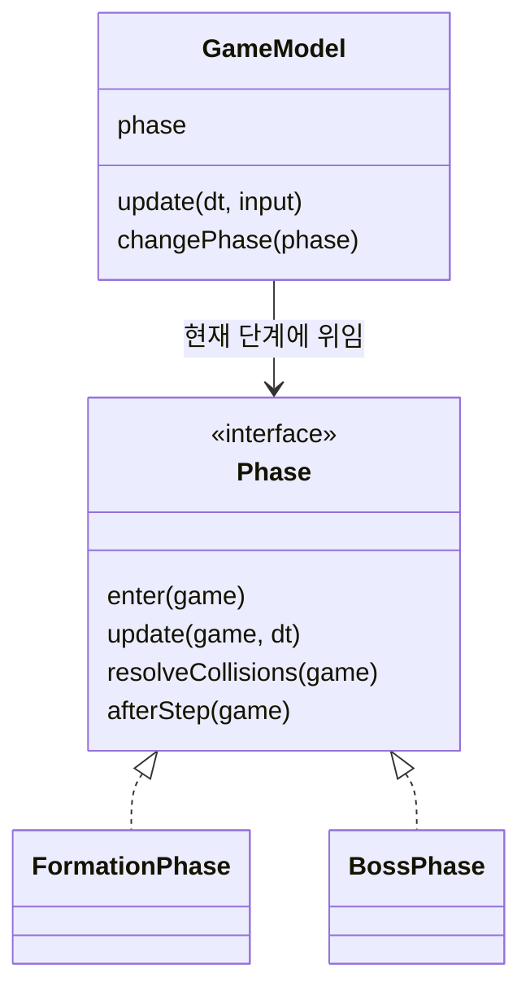
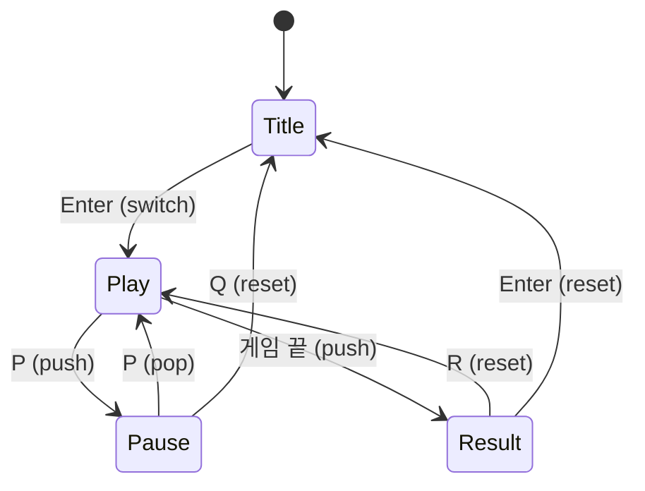

# 5주차 — State 패턴: 씬 전환(FSM) + 진행 단계 분리

> **소요:** 8시간
> **선행:** 4주차(`galaga_mvc_full`: View·Controller 연결, 유도 미사일·보스 추가, 번짐 실측)
> **이번 주 한 문장:** 화면 흐름(타이틀·플레이·일시정지·결과)과 게임 진행 단계(편대전·보스전)를 **State 객체**로 나누고, **동작이 1스텝도 바뀌지 않았음을 테스트로 증명**한다.

---

## 🔗 지난주에 남긴 숙제 (이번 주에 회수한다)

| 남긴 것 | 어디서 | 이번 주 결과 |
|--------|--------|-------------|
| `GameModel` 에 변경이 몰림 (기능 추가 25 hunk 중 12) | 4주차 6절 "해결 못 한 것" | 보스 규칙을 `BossPhase` 로 이동 → GameModel 안 보스 관련 줄 **25 → 3** |
| 재시작 로직이 Controller 에 `state ~= "playing"` 분기로 박혀 있음 | 4주차 `galaga_mvc_full` | 화면 흐름 키(R·Esc·P·Q)는 **씬**의 책임으로, Controller 는 게임플레이 입력만 |
| 일시정지가 없음 | — | `PauseScene` (스택 push/pop). 일시정지 중 고정 스텝 시간(`acc`)도 쌓이지 않음 |
| "시뮬레이터 결과 줄을 기준값으로 리팩터링 전후 비교" | 3주차 5½절 | **`equivalence_test`**: 4주차와 5주차를 매 스텝 비교 (7개 판, 각각 결말까지 650~1500스텝) |

---

## 🎯 학습 목표

1. State 패턴의 구조(상태 객체 + 상태를 가진 쪽(context) + 전환)를 설명할 수 있다.
2. **단순 FSM**과 **스택 FSM(pushdown automaton)** 의 차이를 일시정지 예로 설명할 수 있다.
3. 게임에는 **두 층의 상태**가 있음을 구분한다: 앱 흐름(씬) / 게임 규칙(진행 단계).
4. 씬이 `love` 를 모르게 하고(`ctx` 주입), 씬끼리 순환 `require` 없이 전환하게 만든다.
5. 리팩터링 전후 동작이 같음을 **특성 테스트**로 증명하고, 그 테스트가 실제 차이를 잡는지 확인한다.

---

## ⏱ 8시간 타임테이블

| 시간 | 블록 | 내용 | 산출물 |
|------|------|------|--------|
| 1.0h | 개념 | State 패턴, 단순 FSM vs 스택 FSM, 두 층의 상태 | 상태도 2장 |
| 0.5h | 설계 | 씬 인터페이스·`ctx`·전환표 | 전환표 |
| 2.0h | 실습 | `starter` 의 `SceneStack`·`PauseScene`·`PlayScene` TODO → `scene_test` 통과 | 씬 전환 동작 |
| 1.5h | 실습 | `BossPhase` 구현 → `phase_test` + **`equivalence_test`** 통과 | 단계 분리 |
| 0.5h | 실습 | 실행 확인 1회 (전체 경로 손으로 한 바퀴) | 동작하는 게임 |
| 1.0h | 비교 | GameModel 변화 실측 + "새 단계/새 씬 추가" 비용 확인 | 비교표 |
| 1.5h | 회고 | 루브릭 재채점(4주차와 비교) + 퀴즈 | 루브릭 |

---

## 1. State 패턴 (개념 1.0h)

### 1-1. 문제: 상태 분기가 코드 곳곳에 흩어진다

4주차 `galaga_mvc_full` 에는 이런 분기가 여러 파일에 퍼져 있었다.

```lua
-- GameModel.lua
if not self.bossSpawned and self.score >= BOSS_SCORE then ... end   -- 등장
if self.boss and self.boss.alive then ... end                         -- 이동·탄막
if boss and boss.alive then for ... end end                           -- 피격
if self.bossSpawned then return end                                   -- 재생성 금지
-- InputController.lua
if key == "r" and self.game.state ~= "playing" then ... end          -- 재시작
-- HudView.lua
if game.state == "gameover" then ... elseif game.state == "won" then ... end
```

위에는 두 종류의 상태가 섞여 있다.
- 위 4줄(GameModel): **"보스전"이라는 게임 진행 상태** 하나에 대한 규칙이 한 파일 안 4곳에 흩어져 있다.
- 아래 2줄(InputController·HudView): **"게임이 끝났다"는 앱 흐름 상태**가 입력과 화면 파일에 흩어져 있다.

상태가 하나 늘 때마다(예: 보너스 스테이지, 일시정지) 이 모든 곳에 `if` 가 늘어난다. 두 종류를 어떻게 나눌지는 1-3절에서 다룬다.

### 1-2. 해결: 상태마다 객체 하나, 규칙은 그 안에



- **상태 객체**(`FormationPhase`, `BossPhase`): 그 상태에서만 적용되는 규칙.
- **상태를 가진 쪽(context)**(`GameModel`): 모든 상태에 공통인 규칙 + "지금 상태"에 위임.
- **전환**: 상태가 스스로 다음 상태를 정한다(`FormationPhase` 가 점수를 보고 `BossPhase` 로).

> Lua 에는 인터페이스 문법이 없다. "같은 이름의 메서드 4개를 가진 테이블"이면 단계가 된다(덕 타이핑). 파일 머리 주석이 그 계약서다(바이브 코딩 2원칙).

### 1-3. 두 층의 상태 — 섞지 말 것

| | 앱 흐름 상태 (씬) | 게임 진행 상태 (단계) |
|---|---|---|
| 예 | 타이틀 · 플레이 · 일시정지 · 결과 | 편대전 · 보스전 |
| 어디에 | `scenes/` (조립 계층) | `models/` (Model 안) |
| `love`·화면을 아나 | 화면 흐름은 알지만 `love` 는 `ctx` 로만 | 전혀 모름 (Model 규칙) |
| 결정성 필요 | 아니오 (사람 입력에 반응) | **예** (리플레이·테스트 대상) |
| 바뀌는 계기 | 키 입력 (P, R, Enter) | 게임 규칙 (점수 1000) |

> 흔한 실수: `PauseScene` 을 Model 의 단계로 넣는 것. 일시정지는 **게임 규칙이 아니라 앱 흐름**이다. Model 은 일시정지를 몰라야 한다. 실제로 일시정지는 Model 의 `update` 를 **부르지 않는 것**으로 구현된다.

### 1-4. 단순 FSM vs 스택 FSM (pushdown automaton)



- **단순 FSM**: 현재 상태 하나만 기억. Play → Pause 로 가면 Play 는 사라진다 → 재개하려면 게임 상태를 따로 저장해야 한다.
- **스택 FSM**: Pause 를 Play **위에 쌓는다**. Play 는 그대로 살아 있고 멈춰 있을 뿐. Pause 를 빼면(pop) 정확히 그 자리에서 이어진다.

| 연산 | 의미 | 예 |
|------|------|----|
| `push(scene)` | 위에 쌓기 (아래는 `pause`) | Play → Pause, Play → Result |
| `pop()` | 맨 위 빼기 (드러난 씬은 `resume`) | Pause → Play |
| `switch(scene)` | 맨 위 교체 | Title → Play |
| `reset(scene)` | 전부 비우고 새로 | Pause → Title, Result → 새 Play |

> `hump.gamestate` 도 `switch` 와 `push/pop` 을 모두 제공한다. 이번 주는 라이브러리 대신 100줄 남짓한 `SceneStack` 을 직접 만들어 원리를 본다.

---

## 2. 설계 — 씬이 love 를 모르게 (0.5h)

### 2-1. 씬 인터페이스 (모두 선택)

```lua
scene:enter()  scene:exit()       -- 스택에 들어올 때 / 완전히 빠질 때
scene:pause()  scene:resume()     -- 위에 다른 씬이 덮일 때 / 다시 맨 위가 될 때
scene:update(dt)  scene:draw(gfx)  scene:keypressed(key)
scene.transparent = true          -- 아래 씬도 함께 그린다
scene.stack                       -- SceneStack 이 push 할 때 넣어 준다
```

### 2-2. `ctx` — 씬이 받는 모든 것

```lua
-- main.lua (love 를 아는 유일한 파일)
local ctx = {
  width = 600, height = 800,
  isDown = love.keyboard.isDown,   -- Controller 용
  seed = newSeed,                  -- 새 게임마다 시드 (비결정 요소는 조립부에서만) — 아래 ⚠️
  quit = love.event.quit,          -- 타이틀의 Esc
  scenes = { Title = ..., Play = ..., Pause = ..., Result = ... },
}
```

- 씬은 `love` 대신 `ctx` 만 쓴다 → 테스트에서는 **가짜 ctx**(`helper.fakeCtx`)를 넣는다.
- ⚠️ **시드를 `os.time` 그대로 쓰면 안 된다.** `os.time` 은 초 단위다. 그래서 1초 안에 R 로 재도전하면 **방금과 똑같은 판**이 나온다(검토 중 발견). `main.lua` 의 `newSeed` 는 판 번호를 섞어 이를 막는다. 결정성은 "같은 시드면 같은 판"이지, "매번 같은 판"이 목표가 아니다.
- **`ctx.scenes`**: Title → Play → Result → Title 처럼 씬끼리 서로 `require` 하면 **순환 require** 가 생겨 Lua 가 로드에 실패한다. 씬 목록을 조립부가 한 번 주입하면 순환이 사라진다. 새 씬을 추가할 때도 **main 에 한 줄**만 추가하면 된다.
- `layer_check` 가 "씬은 love 금지, 씬끼리 require 금지"를 검사한다.

### 2-3. 계층별 책임 변화 (4주차 → 5주차)

| 책임 | 4주차 | 5주차 |
|------|-------|-------|
| 프레임 루프(C→M→drain→V) | `main.lua` | `PlayScene` (그대로 옮김) |
| R 재시작, Esc 종료 | `InputController:keypressed` | `ResultScene`, `TitleScene` |
| GAME OVER / YOU WIN 문구 | `HudView` | `ResultView` |
| 보스 등장·이동·피격·승리 | `GameModel` (4곳) | `BossPhase` (1파일) |
| 편대 재생성 | `GameModel` | `FormationPhase` |
| `InputController` | 입력 + 재시작·종료 | **게임플레이 입력만** (`game` 참조도 필요 없어짐) |

---

## 3. [실습] 씬 전환 (2.0h)

`examples/starter/` 는 완성본에서 다음만 비웠다.

| 파일 | 비운 것 | 검사 |
|------|--------|------|
| `scenes/SceneStack.lua` | push·pop·switch·reset·update·keypressed·draw | `scene_test` "SceneStack:" 3개 |
| `scenes/PauseScene.lua` | `transparent`, `keypressed` | `scene_test` 일시정지 계열 |
| `scenes/PlayScene.lua` | 결과 push, P 키 | `scene_test` 결과·전체 경로 |
| `models/BossPhase.lua` | `enter`·`update`·`resolveCollisions` | 4절 |

```sh
cd lua_tuto/mvc/week05/examples/tests
luajit layer_check.lua starter       # 항상 OK
luajit scene_test.lua starter        # 처음: 통과 0 / 실패 16  (SceneStack 이 비어 있어 전부 실패)
```

순서: **SceneStack → PauseScene → PlayScene**. `SceneStack` 3개 테스트가 먼저 통과해야 나머지가 의미 있다.

### 3-1. 일시정지가 "공짜로" 되는 이유
`SceneStack:update` 는 **맨 위 씬에만** `update` 를 준다. Pause 가 위에 있으면 PlayScene 의 `update` 가 불리지 않는다 → 게임이 멈추고 `acc` 도 쌓이지 않는다. 재개 직후에는 밀린 시간을 따라잡지 않고 1스텝만 진행한다(`scene_test` 가 검사).

> ⚠️ 만약 모든 씬에 update 를 준다면? 일시정지 중에도 게임이 돈다. 실제로 그렇게 고쳐 보면 `scene_test` 3개가 실패한다(확인함).

### 3-2. 결과 화면은 왜 switch 가 아니라 push 인가
결과 화면(`transparent`) 아래에 **멈춘 마지막 판**이 보이게 하려고. push 했으니 PlayScene 은 살아 있지만 맨 위가 아니라 update 를 받지 못한다 → 결과 화면이 **한 번만** 쌓인다(따로 플래그가 필요 없다).

---

## 4. [실습] 진행 단계 분리 + 동작 보존 증명 (1.5h)

### 4-1. GameModel 의 한 스텝 (5주차)

```lua
-- 공통: 플레이어 이동·발사·미사일·총알 이동
self:_updateFormation(dt)
self:_updateEnemyFire(dt)
self.phase:update(self, dt)              -- 단계: (편대전) 보스 전환 검사 / (보스전) 보스 이동·탄막
-- 공통: 적 총알 이동
self:_resolveCollisions()                -- 공통: 총알×적, 적총알×플레이어
self.phase:resolveCollisions(self)       -- 단계: (보스전) 총알×보스, 승리
self.phase:afterStep(self)               -- 단계: (편대전) 전멸 시 재생성
```

**호출 위치가 4주차의 원래 코드 위치와 정확히 같다.** 그래서 동작이 바뀌지 않는다.

### 4-2. 리팩터링은 "동작을 바꾸지 않는다" — 어떻게 증명하나
`equivalence_test.lua` 는 4주차 `GameModel` 과 5주차 `GameModel` 을 **한 프로세스에 둘 다 불러** 같은 시드·같은 입력으로 나란히 돌리며, **매 스텝** 관찰 가능한 상태(점수·라이프·좌표·총알·적·보스·RNG 상태·이벤트 순서)를 비교한다.

- 시드 5개(라이프를 양쪽 똑같이 늘려 결말까지) + 승리 경로 + 기본 라이프 게임오버 경로 → 7개 판, 각각 결말까지 650~1500스텝을 매 스텝 비교 → 전부 동일
- **반쪽 검사 방지**: 비교 범위가 다음을 모두 만족하는지 따로 검사한다.
  - 보스전을 포함했는가
  - 모든 판이 중간에 잘리지 않고 결말까지 갔는가
  - 승리와 게임오버를 모두 거쳤는가
  - 시드마다 실제로 다른 플레이가 나왔는가 (3가지 이상)
- **이 테스트가 정말 잡는가?** 다음 두 변경을 넣으면 실패한다(확인함).
  - `FormationPhase` 의 한 줄(전환 스텝에 보스도 한 번 움직이기)을 지우면 → **8개 모두 실패**
  - 보스 HP 를 40 → 41 로 바꾸면 → **191~210번째 스텝에서 달라짐**

> ⚠️ **검토에서 고친 것:** 초판 README 는 "5시드 × 7200스텝"이라고 썼다. 실제로는 자동 조종이 빨리 죽어 **9~22초**만 비교했고, 5개 시드가 **사실상 2가지 플레이**로 겹쳤다. "테스트가 얼마나 넓게 확인했는가"도 측정해야 한다는 사례다.

> 이게 3주차에서 "결정성의 진짜 이득"이라고 한 것이다. 2주차 모놀리식(무작위 시드, raw dt)이었다면 이런 비교 자체가 불가능했다.

> 💡 그 한 줄이 왜 필요할까? 4주차 코드는 "보스 등장 → 같은 스텝에 바로 보스 이동"이었다. 단계를 나누면서 무심코 "다음 스텝부터 이동"으로 바꾸기 쉽다. 눈으로는 절대 모를 1/60초 차이지만, **결정성 위에서는 버그**다(리플레이가 어긋난다).

---

## 5. 실측 — 무엇이 좋아졌고 무엇이 그대로인가 (1.0h)

```sh
cd lua_tuto/mvc
wc -l week04/examples/galaga_mvc_full/models/GameModel.lua week05/examples/galaga_states/models/{GameModel,FormationPhase,BossPhase}.lua
sed 's/--.*$//' <파일> | grep -cE 'boss|Boss|BOSS|"won"'   # 보스 관련 줄 (주석 제외)
```

| 지표 | 4주차 full | 5주차 |
|------|-----------|-------|
| `GameModel.lua` 줄 수 | 295 | **255** (+ `FormationPhase` 43 · `BossPhase` 54) |
| `GameModel` 안 보스 관련 줄 | 25 | **3** |
| 화면 흐름 키를 아는 파일 | `InputController`, `main` | 씬 4개 (각자 자기 키만) |
| 일시정지 | 없음 | 있음 (Model 무수정) |
| 테스트 | 4주차 37개 | 5주차 새 테스트 33개 + 3주차 model_test·4주차 view_test 회귀 통과 |

### 정직한 해석
- ✅ **보스전 규칙이 한 파일로 모였다.** "보스 체력을 바꿔 줘"는 이제 `BossPhase.lua` 한 파일 요청이다(바이브 코딩 1원칙).
- ✅ **새 단계 추가 비용**: `phase_test` 의 "BonusPhase" 테스트가 보여주듯 **GameModel 을 고치지 않고** 새 단계를 끼울 수 있다.
- ✅ **새 씬 추가 비용 (실제로 만들어 잼)**: 도움말 화면 `HelpScene` 을 추가하는 데 든 것은 다음과 같다.
  - 새 파일 2개: Scene, View
  - 기존 파일: `main.lua` 1줄, `TitleScene` 2줄 (+ 테스트 helper 1줄)
  - 나머지 씬·Model·Controller 는 0줄이고, 기존 `scene_test` 는 16/16 그대로 통과한다.
- ⚠️ **보스가 GameModel 에서 완전히 사라지지는 않았다(3줄).** 유도 미사일이 보스도 목표로 삼기 때문이다(`_steerMissiles`). 이건 "단계"가 아니라 **"어떤 대상이 표적이 될 수 있는가"** 라는 다른 축의 문제다 → 엔티티를 목록 하나로 다루는 구조(ECS·컴포넌트)에서 풀린다. 이번 과정에서는 다루지 않는다.
- ⚠️ **코드는 또 늘었다**(GameModel+단계 352줄 vs 295줄, 씬 계층 신설). State 패턴의 이득은 줄 수가 아니라 **"상태를 추가할 때 기존 코드를 안 고친다"** 에 있다.
- ⚠️ **단계 전환 시점의 미묘함**: 전환된 스텝에 새 단계를 한 번 더 돌릴지(4-2 💡)는 패턴이 정해 주지 않는다. **결정은 사람이, 확인은 테스트가.**

---

## 6. 테스트 지도

| 테스트 | 개수 | 무엇을 |
|--------|------|-------|
| `layer_check` | — | 씬도 love 금지, 씬끼리 require 금지, Controller 는 Scene require 금지 |
| `scene_test` | 16 | SceneStack 콜백 순서·투명 그리기·맨 위만 update, 전체 전환 경로, 일시정지 시간 정지, 결과 1회 push, 새 게임 시드 |
| `phase_test` | 9 | 단계 전환, 단계별 규칙, **격파 스텝 동시 명중(경계 상황)**, 새 단계 끼우기, GameModel 에 보스 규칙 없음(정적) |
| `equivalence_test` | 8 | 4주차와 매 스텝 동일(7개 판, 결말까지) + 비교 범위 점검(보스전·결말·두 결말·플레이 다양성) |
| 회귀 | — | 3주차 `model_test`(14) · 4주차 `view_test`(9) 를 5주차에 그대로 실행 |

> ⚠️ **무작위 비교로는 부족하다.** 변이 검사 중, 격파 후 `break` 를 빼먹은 버그를 `equivalence_test` 가 **못 잡았다**. 격파 스텝에 총알 2발 이상이 동시에 맞는 일이 무작위 플레이에서 거의 안 생기기 때문이다. 그래서 그 경계 상황을 `phase_test` 로 일부러 만들어 고정했다. **시뮬레이션 비교와 경계 단위 테스트는 서로를 대신하지 않는다.**

> 회귀 실행: `cd week03/examples/tests && luajit model_test.lua ../../week05/examples/galaga_states/models` / `cd week04/examples/tests && luajit view_test.lua ../../week05/examples/galaga_states`

---

## 7. ⚠️ 흔한 실수

| 실수 | 왜 문제인가 | 올바른 방향 |
|------|------------|-------------|
| 일시정지를 Model 의 상태(`state = "paused"`)로 구현 | Model 이 앱 흐름을 알게 됨. 모든 규칙에 "일시정지면 건너뛰기"가 퍼진다 | 씬 스택: 맨 위가 아니면 update 를 안 받는다 |
| 씬끼리 서로 `require` | 순환 require → 로드 실패 | `ctx.scenes` 로 조립부가 주입 |
| `SceneStack:update` 가 모든 씬을 update | 일시정지 중에도 게임이 돈다 | 맨 위만 |
| 재개 시 밀린 시간을 한꺼번에 처리 | 재개 순간 수백 스텝이 돌아 순간이동 | 멈춘 동안 `acc` 를 쌓지 않는다 |
| 결과 화면을 `switch` 로 띄움 | 마지막 판 화면이 사라진다, 재시작 시 상태 정리 혼란 | `push` + `transparent`, 나갈 때 `reset` |
| 단계 전환을 GameModel 이 `if score >= ...` 로 판단 | 다시 GameModel 에 단계 지식이 쌓인다 | 단계가 스스로 다음 단계를 정한다 |
| 리팩터링 후 "돌려 보니 잘 되네"로 끝냄 | 1/60초 단위 차이는 눈에 안 보인다 | 이전 버전과 매 스텝 비교하는 특성 테스트 |
| `PlayScene` 안에서 `love.graphics` 사용 | 씬 테스트 불가 | `draw(gfx)` 로 받은 것만 (`layer_check` 가 잡는다) |

---

## 8. 개념 퀴즈

1. State 패턴에서 "상태 객체"와 "상태를 가진 쪽(context)"은 이번 예제에서 각각 무엇인가? 공통 규칙과 상태별 규칙은 어디에 두는가?
2. 일시정지를 단순 FSM 으로 구현하면 어떤 문제가 생기고, 스택 FSM 은 그것을 어떻게 해결하는가?
3. 일시정지는 왜 Model 의 진행 단계가 아니라 씬이어야 하는가? (1-3절 표의 "결정성" 행을 근거로)
4. `ctx.scenes` 가 없으면 무슨 일이 생기는가?
5. `equivalence_test` 가 "보스전이 비교 범위에 포함됐는지"까지 검사하는 이유는?
6. 5절에서 GameModel 에 남은 보스 관련 3줄은 왜 State 패턴으로 지워지지 않는가?

> 정답과 채점 포인트: [강사노트.md](강사노트.md)

---

## 9. 과제 & 체크리스트

### 과제
- [ ] `starter/` 의 TODO(SceneStack, PauseScene, PlayScene, BossPhase)를 채운다.
- [ ] **새 씬 1개** 추가: 타이틀에서 H 키 → 조작법 화면(`HelpScene`, Esc 로 돌아오기). 고친 파일 수를 센다.
- [ ] **(도전) 새 단계 1개** 추가: 보스 HP 가 절반 이하면 탄막이 빨라지는 `BossRagePhase`. `GameModel` 을 고치지 않았는지 `git diff` 로 확인.
- [ ] 4주차 루브릭 4항목을 다시 채점하고 변화를 적는다.

### 합격 체크리스트
- [ ] `luajit layer_check.lua starter` → OK
- [ ] `scene_test` 16/16 · `phase_test` 9/9 · `equivalence_test` 8/8 (`starter` 인자)
- [ ] `love` 로 1회 실행: 타이틀 → 플레이 → 일시정지 → 재개 → 게임오버 → 재도전 → 타이틀
- [ ] "일시정지가 Model 을 전혀 건드리지 않는다"를 코드 위치로 설명할 수 있다

---

## 📁 예제 파일 안내

```
week05/
  README.md, 강사노트.md
  examples/
    galaga_states/                ← 완성본 (4주차 galaga_mvc_full 에서 출발)
      main.lua                    ← ctx 조립 + SceneStack (love 를 아는 유일한 파일)
      scenes/                     ← SceneStack, Title/Play/Pause/Result Scene
      models/FormationPhase.lua   ← 진행 단계 ① (새 파일)
      models/BossPhase.lua        ← 진행 단계 ② (새 파일)
      models/GameModel.lua        ← 공통 규칙 + 단계 위임
      views/Title|Pause|ResultView.lua  ← 새 화면
    starter/                      ← SceneStack·PauseScene·PlayScene 일부·BossPhase 가 TODO
    tests/
      helper.lua                  ← 4주차 helper + scenes 경로 + fakeCtx
      layer_check.lua             ← scenes 규칙 추가
      scene_test.lua (16) · phase_test.lua (9) · equivalence_test.lua (8)
```

### 실행
- 테스트(`examples/tests/` 에서): `luajit <테스트>.lua` (완성본) / `luajit <테스트>.lua starter`
- 게임: `love lua_tuto/mvc/week05/examples/galaga_states`
  - 타이틀 `Enter` 시작 · 플레이 `←/→` `Space` `X` · `P`/`Esc` 일시정지 · 일시정지 중 `Q` 타이틀 · 결과 `R` 재도전, `Enter` 타이틀 · 타이틀 `Esc` 종료

> `equivalence_test` 는 4주차 폴더(`week04/examples/galaga_mvc_full/models`)를 상대 경로로 읽는다. 폴더 구조를 바꾸지 않는다.
