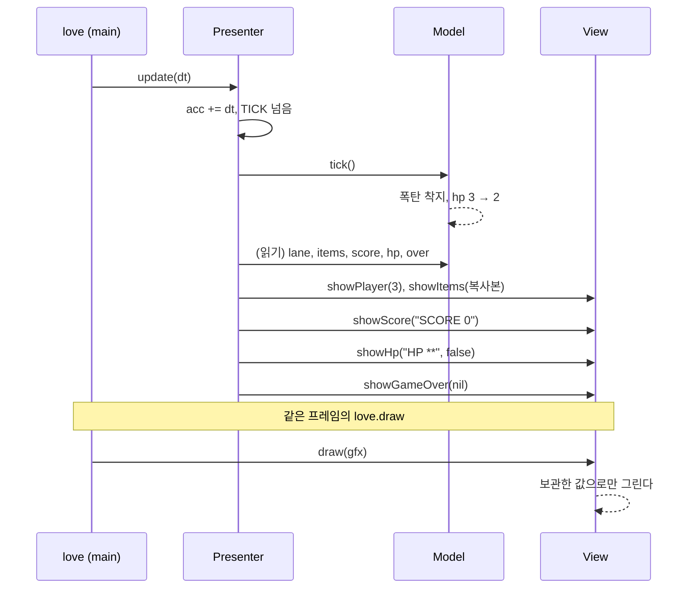
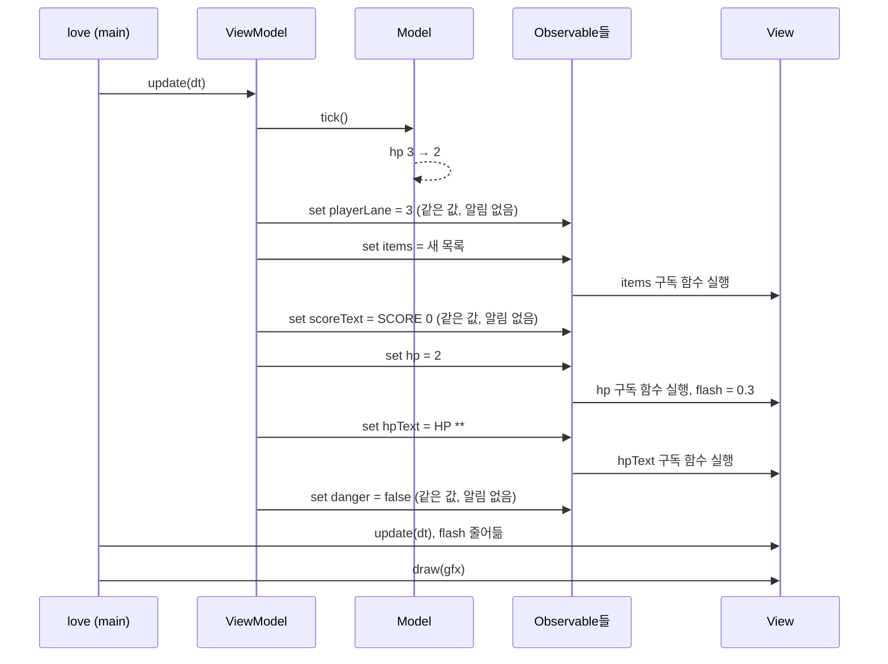
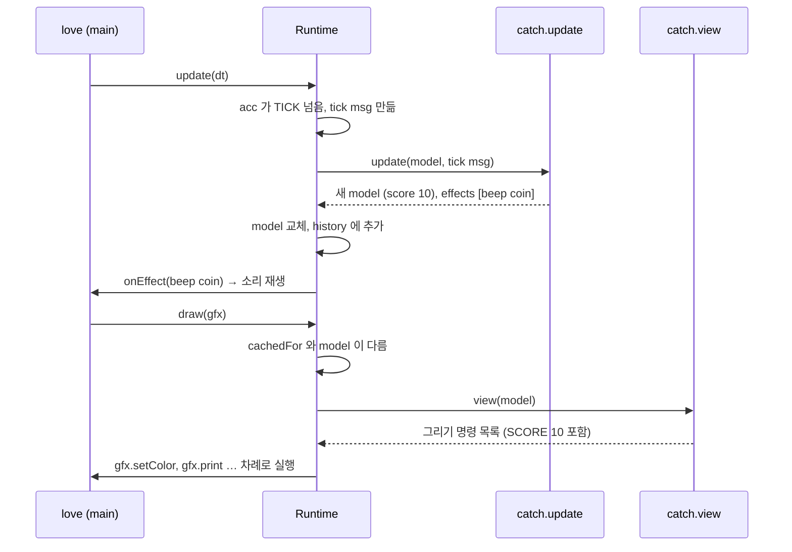
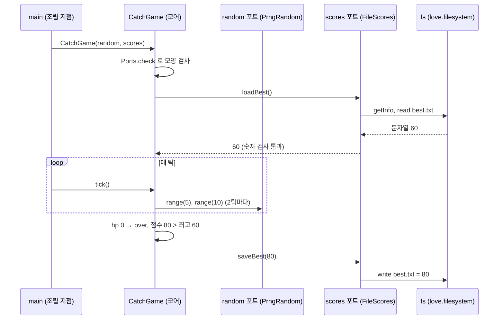
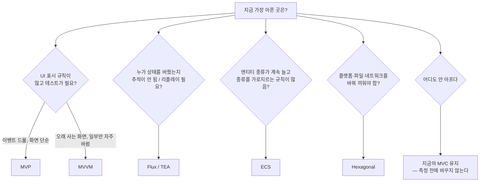

# 8주차(심화) — MVC 의 장단점, 그리고 단점을 메우는 다섯 가지 구조

> **성격:** 선택 심화. 7주 과정을 마친 뒤 읽는다. 정해진 시간표는 없으며, 권장 분량은 6~8시간이다.
> **선행:** 3~7주차. 특히 3주차(Pull 갱신), 5주차("못 지운 보스 3줄"), 6주차(Flux), 7주차(`ctx.storage`)
> **이번 주 한 문장:** MVC 는 "나누기"의 출발점이지 종착점이 아니다. **단점 하나에 처방 하나**가 있고, 처방마다 **새로 내는 값**이 있다. 같은 게임을 여섯 번 만들고, 규칙이 같은지는 테스트로 확인한다.

---

## 🔗 지난 과정에서 넘어온 질문

| 질문 | 어디서 | 이번 주 답 |
|------|--------|-----------|
| "우리 구조는 MVP 가 아니라는데, 그럼 MVP 는 뭔가?" | 3주차 1-3절 | 4-1절 MVP · `catch_mvp` |
| View 가 문구·색을 정하면 테스트에 가짜 gfx 가 필요하다 | 4주차 `view_test` | 2-3절, `mvc_test` 의 `[불편]` |
| "못 지운 보스 3줄" — 엔티티 종류 축의 결합 | 5주차 5절 | 4-4절 ECS · `catch_ecs` |
| Flux 말고 다른 단방향 구조는? | 6주차 | 4-3절 TEA · `catch_tea` |
| `ctx.storage` 처럼 바깥 세계를 주입하는 걸 구조로 만들면? | 7주차 1절 | 4-5절 Hexagonal · `catch_hex` |
| "ECS 는 언제 배워요?" | 7주차 강사노트 | 지금 |

---

## 🎯 학습 목표

1. MVC 의 장점 다섯 가지와 단점 일곱 가지를 **이 과정의 코드와 테스트를 근거로** 설명한다.
2. 단점마다 어떤 구조가 처방인지 짝지어 말한다. (MVP·MVVM·Flux/TEA·ECS·Hexagonal)
3. 각 구조가 **새로 만드는 비용**을 테스트에서 찾아 말한다. (`[비용]`·`[누수]`·`[함정]`·`[확장 비용]`)
4. "구조를 바꿔도 규칙은 그대로"를 `equivalence_test` 로 보인다.
5. 실제 게임에서는 구조를 **섞어 쓴다**는 것을 알고, 내 게임의 부분마다 구조를 고른다.

---

## 1. MVC 다시 보기

```text
 입력·시간 ──▶ Controller ──(명령)──▶ Model ◀──(읽기)── View ──▶ 화면
                                       │
                                       └── Model 은 View·Controller 를 모른다
```

- **Model**: 상태와 규칙. 화면도 입력 장치도 모른다.
- **View**: Model 을 읽어서 그린다.
- **Controller**: 입력(그리고 게임에서는 **시간**)을 Model 호출로 바꾼다.

고전 MVC(1979, Smalltalk-80)에서는 Model 이 바뀌면 View 에 **통지(Push, Observer)** 한다. 이 과정의 MVC 는 역할과 의존 방향이 같지만, 갱신은 **매 프레임 다시 읽기(Pull)** 로 한다(3주차 1-3절). 게임은 어차피 매 프레임 화면 전체를 다시 그리기 때문이다. 아래 장단점은 두 방식을 모두 다루고, 둘이 갈리는 곳은 따로 표시한다.

---

## 2. MVC 의 장점과 단점

### 2-1. 장점

| # | 장점 | 이 과정의 근거 | 게임에서의 의미 |
|---|------|---------------|----------------|
| ① | **관심사 분리**: 규칙, 그리기, 입력이 각자 파일 하나 | 2주차 모놀리식 → 4주차 분리 후 번짐 실측 | 기획이 "점수 규칙"을 바꿔도 그리기 코드는 열지 않는다 |
| ② | **헤드리스 테스트**: Model 은 love 없이 돈다 | 4~7주차 `tests/` 전부 | CI 에서 창 없이 수천 판을 돌리고, 밸런스 시뮬레이션을 할 수 있다 |
| ③ | **View 교체·추가**: 같은 Model 에 View 가 여럿 | 4주차 `HudView`·`EffectsView`, 6주차 `ReplayView` | 디버그 오버레이, 관전 화면, 미니맵을 Model 수정 없이 붙인다 |
| ④ | **결정성의 바탕**: Model 이 시간·난수를 주입받는다 | 3주차 결정성, 6주차 리플레이 | 리플레이, 버그 재현, 고스트 레이스, 롤백 넷코드의 출발점 |
| ⑤ | **보편성**: 누구나 아는 어휘 | 웹·앱·엔진 문서 어디나 | 팀 합류가 쉽다. "그거 View 에 넣지 마세요" 한 마디로 통한다 |

### 2-2. 단점 — 일곱 가지

#### ❶ "C" 의 뜻이 사람마다 다르다

웹 프레임워크의 Controller(요청 → 응답), 데스크톱 GUI 의 Controller(위젯 이벤트), 게임의 Controller(키 상태 + **시간 누적**)는 서로 하는 일이 다르다. 이름은 같은데 하는 일이 다르면 리뷰에서 "이건 어디에 둘까"라는 논쟁이 반복된다.

- 이 과정에서 실제로 있었던 일: 시간 누적(`acc`)을 Controller 에 둘지 Model 에 둘지(4주차), 씬 조립을 어디에 둘지(5주차 `scenes/` 신설).
- **처방**: 역할 이름을 더 좁힌다. Presenter(MVP), ViewModel(MVVM), Runtime(TEA), System(ECS), Adapter(Hexagonal).

#### ❷ 비대해지는 쪽이 생긴다 (Massive Controller / Massive Model)

규칙이 늘면 "어디에도 안 맞는" 코드가 Controller 에 쌓이거나, Model 하나에 모든 종류의 엔티티가 몰린다. 겔러그 `GameModel` 이 그랬고, 5주차에 진행 단계(State)를 따로 빼서야 줄었다.

- **처방**: 상태 변경을 한 곳으로 모으고 규칙을 순수 함수로 쪼갠다(Flux/TEA). 또는 종류별 클래스를 컴포넌트와 시스템으로 바꾼다(ECS).

#### ❸ View 가 Model 을 직접 안다 — 필드 이름 결합과 "표시 규칙"의 위치

Pull 방식 View 는 `model.score`, `model.hp` 같은 **내부 필드 이름**을 직접 읽는다. 그리고 "HP 가 1 이면 빨간색", "점수 앞에 SCORE" 같은 **표시 규칙**이 View 안에 들어간다.

- 필드 이름이 바뀌면 View 가 깨진다. `mvc_test` 의 `[결합 측정]`: `CatchView` 는 Model 필드 **5개**를 직접 읽는다.
- 표시 규칙을 검사하려면 가짜 gfx 로 draw 전체를 돌리고 `setColor` 호출 순서를 뒤져야 한다(`mvc_test` 의 `[불편]` 두 개).
- **처방**: 표시 규칙을 View 밖으로 빼서 **값**으로 만든다. Presenter 가 밀어 주거나(MVP), ViewModel 속성에 바인딩한다(MVVM).

#### ❹ 상태를 바꾸는 길이 여럿이다

Controller 도, 씬도, 이벤트 처리기도 Model 메서드를 부를 수 있다. 버그가 나면 "**누가, 언제, 왜** 이 값을 바꿨나"를 따라가기 어렵다. 결과(점수·좌표)는 남지만 원인 목록은 남지 않는다(6주차 1-1절).

- **처방**: 상태를 바꾸는 길을 **메시지(Action/Msg) 하나**로 좁힌다. Flux(6주차), TEA(이번 주).

#### ❺ 갱신 방식의 딜레마 — Push 든 Pull 이든 대가가 있다

| 방식 | 문제 |
|------|------|
| **Push** (고전 MVC, Observer) | 통지가 폭주한다(값 하나 바뀔 때마다). 통지 순서에 기대는 버그가 생기고, 구독 해제를 잊으면 누수가 생긴다 |
| **Pull** (이 과정) | 매 프레임 전부 읽는다. "**방금 바뀌었다**"를 알기 어렵다. 그래서 피격 깜빡임 같은 일회성 연출을 위해 Model 이 이벤트 큐(`drainEvents`, 4주차)를 따로 가져야 했다 |

- **처방**: 바뀔 때만 알리되 **값 단위로 비교**한다(MVVM 의 Observable). 또는 상태를 불변으로 만들어 "참조가 같으면 변화 없음"으로 판정한다(TEA: 비교 한 번으로 view 캐시).

#### ❻ 엔티티 "종류" 축의 결합

MVC 는 **계층**(규칙 · 그리기 · 입력)을 나눈다. 그런데 게임에서 더 빨리 늘어나는 것은 **종류**다. 적, 보스, 아이템, 투사체가 계속 추가된다. 종류마다 Model·View 클래스를 만들면 조합이 폭발한다. "보스도 유도 미사일의 표적이 될 수 있다"처럼 종류를 가로지르는 규칙은 어느 클래스에도 깔끔히 들어가지 않는다. 5주차의 **"못 지운 보스 3줄"** 이 바로 이 문제다.

- **처방**: 종류를 **클래스가 아니라 컴포넌트 조합(데이터)** 으로 표현한다. ECS.

#### ❼ 바깥 세계(파일·시간·난수·플랫폼)가 Model 에 스며든다

`os.time`, `math.random`, `love.filesystem` 이 Model 안에 들어오면 결정성과 테스트가 한꺼번에 깨진다. 이 과정은 규칙으로 막았다(`layer_check`, 7주차 `ctx.storage`). 하지만 MVC 자체에는 "바깥 세계"라는 개념이 없어서, 이 규칙은 팀이 관례로 지켜야 한다.

- **처방**: 코어가 바깥에 요구하는 것을 **포트**로 이름 붙이고, 구현은 **어댑터**로 꽂는다. Hexagonal(Ports & Adapters).

#### (덤) 작은 게임에는 과하다

Pong 하나에 파일 열 개는 과하다. 2주차에서 본 것처럼 모놀리식이 더 빠른 구간이 분명히 있다. 이 단점은 아래 다섯 구조 모두에 똑같이, 그리고 대부분 **더 크게** 해당한다.

### 2-3. 단점 → 처방 지도

| MVC 의 단점 | 처방 | 예제 | 새로 내는 값 |
|------------|------|------|-------------|
| ❸ View 가 Model 을 앎, 표시 규칙 테스트 어려움 | **MVP** (Passive View) | `catch_mvp` | View 인터페이스가 수다스럽다, Presenter 비대 |
| ❸❺ 위와 같음 + 갱신 통지 | **MVVM** (데이터 바인딩) | `catch_mvvm` | 바인딩 디버깅, 누수, 같은 테이블 함정 |
| ❹❷ 변경 경로가 여럿, Model 비대 | **Flux / TEA** (단방향) | 6주차 `snake_flux`, `catch_tea` | 매번 새 테이블(할당), 모든 것이 msg 하나를 거침 |
| ❻ 종류 축 결합 | **ECS** | `catch_ecs` | 흐름이 흩어져 읽기 어려움, 작은 게임엔 과함 |
| ❼ 바깥 세계 침투 | **Hexagonal** | `catch_hex` | 인터페이스·파일 증가, 포트 설계가 어렵다 |
| ❶ "C" 의 모호함 | 위 전부(역할 이름을 좁힘) | — | — |

---

## 3. 공통 예제 — "동전 받기 (Catch)"

다섯 구조를 공정하게 비교하려고 **같은 게임**을 여섯 번(기준 MVC 포함) 만들었다.

```text
 SCORE 20            HP ***
┌────┬────┬────┬────┬────┐
│    │ ●  │    │    │    │  1   ● 동전(노랑) +10
│    │    │    │ ●  │    │  2   ● 폭탄(빨강) HP -1
│    │    │    │    │    │  …
│    │    │    │    │    │  5
│    │    │ ▬▬ │    │    │  6 = 플레이어 줄
└────┴────┴────┴────┴────┘
```

### 규칙 명세 (`rules.lua` + 아래 순서)

- 5칸 × 6줄, 플레이어는 6번 줄, 3번 칸에서 시작. ←/→ 로 한 칸씩 이동(벽에서 멈춤).
- **한 틱(0.25초)** 의 순서:
  1. 틱 수 +1
  2. 모든 아이템이 한 줄 내려온다. 6번 줄에 닿으면 판정하고 사라진다. 플레이어와 같은 칸이면 동전 +10, 폭탄 HP −1.
  3. HP ≤ 0 이면 게임 오버. 이후 틱과 이동은 무시한다.
  4. 2틱마다 1번 줄에 새 아이템. 칸은 `prng.range(5)`, 종류는 `prng.range(10) ≤ 3` 이면 폭탄.
- 난수는 6주차와 같은 Park–Miller `prng.lua`. **시드가 같으면 판이 같다.**

`rules_test` 가 이 명세를 기준 구현(`catch_mvc`)으로 확인하고, `equivalence_test` 가 **나머지 다섯 구조가 300단계 동안 매 단계 같은 상태**인지 시드 4개로 확인한다.

> 💡 `CatchModel.lua` 는 `catch_mvc`·`catch_mvp`·`catch_mvvm` 에 **똑같은 파일**로 들어 있다. MVP·MVVM 은 Model 이 아니라 **표시 쪽**을 바꾸는 구조이기 때문이다. TEA·ECS·Hexagonal 은 규칙을 담는 방식 자체가 달라서 각자 다시 썼고, 그래서 `equivalence_test` 가 필요하다.

---

## 4. 다섯 가지 구조

각 절은 같은 순서로 읽는다.

1. **고치는 단점**과 그림
2. **비유**: 한 문장으로 감 잡기
3. **탄생 배경**: 어떤 고통에서 나왔나
4. **부품과 책임**: 누가 무엇을 알고 모르나 (예제 파일과 짝지음)
5. **한 번의 흐름 따라가기**: 예제에서 입력 하나, 틱 하나가 어디를 지나가나
6. **나란히 보기**: MVC(또는 이웃 구조)와 코드로 비교
7. **변형과 용어**, **흔한 오해**, **코드 읽기 순서**
8. **핵심 코드 → 테스트가 보여 주는 것 → 새로 내는 값 → 게임에서 → 쓰지 말아야 할 때**

> 처음 읽을 때는 2·4·5만 읽고 예제를 실행해 본 뒤, 나머지를 읽어도 된다.

### 4-1. MVP — Model-View-Presenter (Passive View)

**고치는 단점:** ❸ View 가 Model 을 안다, 표시 규칙을 테스트하기 어렵다.

```text
 입력 ──▶ Presenter ──(명령)──▶ Model
             │  ▲
   (값을 밀어 넣음) │  └── (Model 을 읽음)
             ▼
           View  (Model 을 모름. 받은 값을 그리기만 함)
```

#### 비유

MVP 는 **"통역사를 둔 무대"** 다. 배우(View)는 건네받은 대사(값)를 읽기만 한다. 통역사(Presenter)가 원작(Model)을 읽고, 관객에게 보일 대사로 바꿔 배우에게 **직접 건넌다**. 배우는 원작을 펼쳐 보지 않는다.

#### 탄생 배경

1990년대 Taligent(애플·IBM 합작)에서 MVC 의 Controller 역할을 다시 정의하며 이름이 붙었다. 이후 Dolphin Smalltalk 를 거쳐 데스크톱 GUI 로 퍼졌고, Martin Fowler 가 View 에 일을 얼마나 남기느냐에 따라 두 변형(아래)으로 정리했다.

동기는 하나다. **화면(위젯, gfx)은 자동 테스트하기 어렵다. 그러니 View 를 최대한 얇게 만들고, 판단은 전부 테스트하기 쉬운 객체로 옮기자.** `mvc_test` 의 `[불편]` 두 개가 바로 이 고통이다.

#### 부품과 책임

| 부품 | 하는 일 | 아는 것 | 모르는 것 | 예제 |
|------|--------|--------|----------|------|
| **Model** | 규칙과 상태 | 자기 자신 | Presenter, View | `models/CatchModel.lua` (MVC 와 **같은 파일**) |
| **Presenter** | 입력·시간 → Model 명령. Model → "보일 값" 계산 → View 에 전달 | Model, **View 계약**(`show*` 다섯 개) | gfx, love, 픽셀 좌표 | `presenters/CatchPresenter.lua` |
| **View** | 받은 값을 보관하고 그린다 | View 계약, gfx, 레이아웃(칸 크기·색) | Model, 게임 규칙 | `views/CatchView.lua` |
| **main** | 조립, love 콜백 연결 | 전부 | — | `main.lua` |

한 줄로 나누면 이렇다. **"무엇을 보일까"(문구, 위험 여부, 게임 오버 여부)는 Presenter, "어떻게 그릴까"(좌표, 색 값, 원인지 사각형인지)는 View.**

MVC 의 Controller 는 어디로 갔나? Presenter 가 흡수했다. 시간 누적(`acc`)과 키 해석(`MOVES`)이 모두 `CatchPresenter` 안에 있다.

#### 한 번의 흐름 따라가기 — 폭탄을 맞는 틱



1. **시간은 Presenter 가 센다.** `update(dt)` 가 쌓여서 TICK 을 넘으면 `model:tick()` 을 부른다.
2. **틱이 한 번이라도 있었을 때만** `present()` 를 부른다. 아무 일도 없는 프레임에는 View 에 아무것도 보내지 않는다.
3. `present()` 는 Model 을 읽고 **화면용 값**을 만든다. `hp = 2` 는 `"HP **"` 와 `danger = false` 가 된다. 이 변환이 곧 "표시 규칙"이다.
4. View 는 `draw` 할 때 Model 을 보지 않는다. Presenter 가 마지막으로 넘긴 값의 **사진**을 그릴 뿐이다.

반대 방향(입력)도 같다. `love.keypressed("left")` → `presenter:onKey("left")` → `model:move(-1)` → `present()` → `view:showPlayer(2)` … 순서로 진행된다.

#### MVC 와 나란히

```lua
-- MVC: catch_mvc/views/CatchView.lua — View 가 판단한다
if model.hp <= 1 then gfx.setColor(1, 0.3, 0.3) end
gfx.print("HP " .. string.rep("*", model.hp), 200, 12)

-- MVP: Presenter 가 판단하고 (catch_mvp/presenters/CatchPresenter.lua)
v:showHp("HP " .. string.rep("*", m.hp), m.hp <= 1)
-- View 는 받은 판단을 그대로 그린다 (catch_mvp/views/CatchView.lua)
if self.danger then gfx.setColor(1, 0.3, 0.3) end
gfx.print(self.hpText, 200, 12)
```

View 에 `if` 가 여전히 남아 있는 것처럼 보인다. 하지만 **판단 근거**(`hp <= 1`)는 Presenter 로 갔다. View 의 `if self.danger` 는 "위험이면 빨강게"라는 **표현**만 맡는다. 기획이 "HP 2 부터 경고"로 바꾸면 Presenter 한 줄만 고치고, 테스트도 Presenter 만 본다.

#### 변형과 용어

- **Passive View**(이 예제): View 에는 값 넣기(`show*`)와 `draw` 뿐이다. 테스트 범위가 가장 넓고, 인터페이스는 가장 수다스럽다.
- **Supervising Controller**: 점수 숫자처럼 단순한 값은 View 가 Model 에서 직접 가져가고, 복잡한 표시 규칙만 Presenter 가 맡는다. 수다는 줄지만 View 가 다시 Model 을 알게 된다.
- **View 계약(인터페이스)**: Lua 에는 interface 문법이 없다. `CatchPresenter.lua` 맨 위 주석과 테스트의 `fakeView()` 가 계약 역할을 한다. **같은 계약을 두 구현(진짜 View, 가짜 View)이 지킨다**는 것이 곧 MVP 의 테스트 전략이다.
- **Humble Object**: 테스트하기 어려운 부분(그리기)을 최대한 얇게 남기는 패턴이다. Passive View 가 대표 예다.

#### 흔한 오해

- **"Presenter 는 Controller 의 새 이름일 뿐이다"** → 아니다. 이 과정의 Controller 는 View 를 **모른다**. Presenter 는 View 를 **알고 직접 호출한다**. 의존 방향이 다르다.
- **"View 에는 if 가 하나도 없어야 한다"** → 레이아웃이나 색 같은 **표현의 if** 는 괜찮다. 빠져야 하는 것은 **게임 상태에 대한 판단**이다.
- **"MVP 면 View 를 여러 개 붙이기 쉽다"** → 가능은 하지만 Presenter 가 View 마다 다른 계약을 알아야 해서 보통 1:1 이 된다. 한 상태를 여러 화면이 봐야 한다면 MVVM 이 더 자연스럽다.

#### 코드 읽기 순서

1. `presenters/CatchPresenter.lua` 맨 위 주석(View 계약)
2. `CatchPresenter:present()`
3. `views/CatchView.lua` 의 `show*` 다섯 개와 `draw`
4. `tests/mvp_test.lua` 의 `fakeView()` — 두 번째 View 구현
5. `main.lua` 의 조립(`CatchPresenter(CatchModel(seed), view)`)

**핵심:** Presenter 가 "화면에 보일 **값**"을 만들어 View 에 **밀어 넣는다(Push)**. View 는 판단(`if`)이 거의 없는 그릇이다.

```lua
-- presenters/CatchPresenter.lua
function CatchPresenter:present()
  local m, v = self.model, self.view
  v:showScore("SCORE " .. m.score)
  v:showHp("HP " .. string.rep("*", m.hp), m.hp <= 1) -- 위험 여부를 '값'으로
  v:showGameOver(m.over and "GAME OVER  -  R" or nil)
  -- … showPlayer, showItems(복사본)
end
```

**`mvp_test` 가 보여 주는 것**

- `showHp("HP *", true)`: MVC 에서 `setColor` 순서를 뒤져야 했던 "빨간색 규칙"을 **값 비교 한 줄**로 검사한다. gfx 가 필요 없다.
- `[결합 측정]`: View 가 읽는 Model 필드는 **0개**다.
- Presenter 가 넘기는 아이템 목록은 복사본이다. View 가 Model 을 실수로 고칠 수 없다.

**새로 내는 값**

- `[비용]` 이동 한 번에도 View 호출이 5번 일어난다. 화면 요소마다 `show*` 메서드가 생기는 **수다스러운 인터페이스**다. 요소가 50개인 상점 UI 라면?
- Presenter 와 View 가 보통 1:1 로 짝지어져 **파일 수가 두 배**가 되고, Presenter 가 새로운 "Massive" 후보가 된다.
- 게임플레이 화면은 매 프레임 거의 전부 바뀐다. 그래서 Push 의 이점(바뀔 때만 그리기)이 작다.

**게임에서:** 메뉴, 설정, 상점, 인벤토리처럼 **이벤트가 드물고 표시 규칙이 많은 UI**에 잘 맞는다. 단위 테스트가 필요한 결제·보상 화면에서 특히 값어치가 크다.

**쓰지 말아야 할 때:** 탄막이나 액션처럼 매 프레임 거의 모든 것이 움직이는 게임플레이 화면. 밀어 넣을 값이 프레임마다 전부 바뀌면 Presenter 는 "Model 을 복사해 넘기는 기계"가 되고, 얻는 것 없이 호출만 늘어난다. 그런 곳은 Pull MVC 나 ECS 의 render 시스템이 낫다.

---

### 4-2. MVVM — Model-View-ViewModel (데이터 바인딩)

**고치는 단점:** ❸ 표시 규칙의 위치, ❺ 갱신 통지(Push 폭주·Pull 의 "방금 바뀜" 모름).

```text
 Model ◀──(명령)── ViewModel ──(속성: Observable)──▶ View
                     ▲                              │
                     └──────────(명령 호출)─────────┘
          ViewModel 은 View 를 모른다. View 가 "구독"한다.
```

#### 비유

MVVM 은 **"경기장 전광판"** 이다. 전광판 관리자(ViewModel)는 "점수", "남은 체력" 같은 칸을 갱신할 뿐, 누가 보고 있는지 모른다. 관중(View)은 보고 싶은 칸을 미리 정해 두고(**바인딩**), 그 칸이 바뀔 때만 고개를 든다. MVP 의 통역사가 배우에게 대사를 **직접 건네는** 것과는 방향이 반대다.

#### 탄생 배경

2005년 Microsoft 의 John Gossman 이 WPF(데이터 바인딩을 기본으로 갖춘 UI 프레임워크)를 위해 소개했다. Martin Fowler 의 **Presentation Model**(화면 상태를 담은 테스트 가능한 객체)에 바인딩 엔진을 결합한 것이다.

동기: MVP 에서 Presenter 가 View 를 일일이 부르던 **수다를 바인딩 엔진에 떠넘기자.** 중간 객체는 값만 바꾸고, "바뀐 값을 화면에 전하는 일"은 엔진이 한다. 이 예제에서는 짧은 `Observable` 모듈 하나가 그 엔진이다.

#### 부품과 책임

| 부품 | 하는 일 | 아는 것 | 모르는 것 | 예제 |
|------|--------|--------|----------|------|
| **Model** | 규칙과 상태 | 자기 자신 | ViewModel, View | `models/CatchModel.lua` (**같은 파일**) |
| **ViewModel** | Model → 화면용 **속성**, 화면이 부를 **명령** 제공, 시간 누적 | Model, Observable | View (누가 몇 명 보는지도) | `viewmodels/CatchViewModel.lua` |
| **Observable** | 값 하나 + 구독자 목록. 바뀔 때만 알림 | 구독 함수들 | 값의 의미 | `core/Observable.lua` |
| **View** | 바인딩 등록·해제, 키 → 명령, 화면 전용 상태(깜빡임), 그리기 | ViewModel 의 속성·명령 이름 | Model | `views/CatchView.lua` |

ViewModel 의 속성은 `playerLane`, `items`, `scoreText`, `hp`, `hpText`, `danger`, `gameOverText` 일곱 개다. Model 을 **화면이 필요로 하는 모양**으로 다시 정리한 것이다. Model 의 `score = 10`(숫자)은 ViewModel 에서 `scoreText = "SCORE 10"`(문구)이 된다. Model 에 있는 `rng`, `ticks` 는 화면에 필요 없으므로 내놓지 않는다.

#### 한 번의 흐름 따라가기 — 폭탄을 맞는 틱



1. ViewModel 은 매번 속성을 **전부 set** 한다(`_sync`). "무엇이 바뀌었나"를 계산하지 않는다.
2. 그 계산은 `Observable:set` 의 `==` 비교가 대신한다. 그래서 ViewModel 코드는 단순하고, View 에는 **바뀐 것만** 도착한다. 위 틱에서 일곱 속성 중 실제로 View 까지 간 것은 세 개다.
3. View 는 `hp` 가 **줄었다는 사실**을 구독 함수에서 알아차리고 깜빡임을 시작한다. Model 에는 "맞았다" 이벤트가 없다.

반대 방향(입력): `view:keypressed("left")` → `vm:moveLeft()` → `model:move(-1)` → `_sync` → `playerLane` 이 2 로 바뀜 → View 의 구독 함수가 `self.lane = 2`. **View 는 자기 `lane` 을 직접 바꾸지 않는다.** 명령을 보내고, 결과는 바인딩으로 돌려받는다.

#### MVP 와 나란히

| | MVP | MVVM |
|---|---|---|
| 갱신을 시작하는 쪽 | Presenter 가 View 를 호출 | View 가 미리 구독 → Observable 이 호출 |
| 중간 객체가 View 를 아나 | 안다(계약) | 모른다 |
| 한 상태를 보는 화면 여럿 | 계약마다 호출 추가 | 구독 하나 더 |
| 바뀌지 않은 값 | 그래도 호출(이동 1회에 5번) | 호출 없음 |
| 테스트 방법 | 가짜 View 로 호출 기록 | 속성 값을 `get()` 으로 바로 확인 |
| 대가 | 수다스러운 인터페이스 | 바인딩 엔진, 누수, 보이지 않는 호출 |

#### 변형과 용어

- **단방향 바인딩**(이 예제): ViewModel → View. 입력은 명령으로 따로 간다.
- **양방향 바인딩**: 슬라이더를 움직이면 `vm.volume` 이 바뀌고, `vm.volume` 이 바뀌면 슬라이더가 움직인다. 설정 화면에서 편리하지만 "누가 먼저 바꾨나" 순환을 조심해야 한다.
- **명령(Command)**: View 가 부를 수 있는 동작(`moveLeft`). 실행 가능 여부를 속성으로 함께 내놓기도 한다. 예를 들어 게임 오버면 `canMove = false` 로 버튼을 회색으로 만든다.
- **변환기(Converter)**: 값 → 표시 형식. 이 예제는 ViewModel 안에서 직접 변환한다(`"HP " .. string.rep("*", hp)`).
- **계산 속성**: 다른 값에서 파생된 속성. `danger = hp <= 1` 이 그 예다.

#### 흔한 오해

- **"ViewModel 은 Model 의 복사본이다"** → 아니다. **화면을 위한 모델**이다. Model 에 없는 것(`danger`, `scoreText`)이 있고, Model 에 있는 것(`rng`, `ticks`)은 없다.
- **"View 에는 상태가 없어야 한다"** → 깜빡임 타이머처럼 **화면에만 있는 상태**는 View 에 두는 것이 맞다. Model 이나 ViewModel 에 넣으면 리플레이와 테스트가 연출에 묶인다.
- **"바인딩하면 갱신은 공짜"** → 구독 함수는 `set` 하는 순간 **동기적으로** 실행된다. 구독 함수에 무거운 일을 넣으면 그 비용은 `set` 한 쪽(여기서는 `vm:update`)이 낸다.

#### 코드 읽기 순서

1. `core/Observable.lua` (`set`, `bind`, 해제 함수가 전부다)
2. `viewmodels/CatchViewModel.lua` 의 속성 목록과 `_sync`
3. `views/CatchView.lua` 의 `init` 안 `_bind` 들, 그리고 `destroy`
4. `main.lua` 의 `newGame` 에서 `view:destroy()` 를 부르는 이유
5. `tests/mvvm_test.lua` 의 `[누수]`·`[함정]`

**핵심:** ViewModel 은 **속성**(Observable)과 **명령**(메서드)만 내놓는다. View 는 시작할 때 **한 번 바인딩**해 두고, 값이 바뀔 때만 들어온다. MVP 와 달리 ViewModel 은 **누가 보고 있는지 모른다**.

```lua
-- core/Observable.lua — 바뀔 때만 알린다
function Observable:set(value)
  if value == self.value then return end
  self.value = value
  for i = 1, #self.subs do self.subs[i](value) end
end

-- views/CatchView.lua — Model 에 "맞았다" 이벤트가 없어도 HP 감소에 반응한다
self:_bind(vm.hp, function(v)
  if self.lastHp and v < self.lastHp then self.flash = CatchView.FLASH end
  self.lastHp = v
end)
```

**`mvvm_test` 가 보여 주는 것**

- 점수가 안 바뀐 틱에는 `scoreText` 구독자가 **불리지 않는다**. Push 폭주를 값 비교로 막는다.
- **피격 깜빡임**을 Model 이벤트 큐 없이 만든다. Pull MVC 의 ❺(방금 바뀌었다를 모름)에 대한 답이다.
- View 는 Model 을 require 하지도, 필드를 읽지도 않는다.

**새로 내는 값**

- `[누수]` View 를 버릴 때 `destroy()`(구독 해제)를 잊으면 ViewModel 이 옛 View 를 계속 붙잡는다. 테스트에서 destroy 없이 View 2개를 만들면 구독이 2개 남는다. 씬 전환이 잦은 게임에서 흔한 메모리·CPU 누수다.
- `[함정]` 비교가 `==` 이므로 **같은 테이블을 고쳐서 다시 set 하면 알림이 없다**. 그래서 `CatchViewModel` 은 `items` 를 매번 새 테이블로 만든다. 6주차 리듀서의 "제자리 수정 금지"와 같은 교훈이다.
- 바인딩은 **보이지 않는 호출 경로**다. "이 값은 누가 바꿨지?"를 디버거로 따라가기 어렵고, 속성 A 의 변경이 B 를 바꾸고 B 가 다시 A 를 바꾸는 순환도 생길 수 있다.
- 바인딩 프레임워크(직접 만들든 엔진 것을 쓰든)라는 **추가 부품**이 필요하다.

**게임에서:** HUD, 인벤토리, 캐릭터 스탯 창처럼 **오래 살아 있고 일부만 가끔 바뀌는 UI**에 잘 맞는다. Unity UI Toolkit 의 런타임 데이터 바인딩, Unreal 의 UMG Viewmodel(MVVM) 플러그인처럼 엔진이 직접 지원하는 경우가 늘고 있다.

**쓰지 말아야 할 때:** 화면 요소가 전부 매 프레임 바뀔 때. set 비용과 구독 호출만 늘고 "바뀔 때만"의 이점이 사라진다. 바인딩 엔진을 만들고 유지할 여력이 없는 작은 프로젝트에도 맞지 않는다.

---

### 4-3. 단방향 흐름 — Flux(6주차)와 TEA(The Elm Architecture)

**고치는 단점:** ❹ 상태를 바꾸는 길이 여럿, ❷ Model 비대, ❺ 변화 감지.

```text
         ┌──────────── msg ◀── 입력 · 시간 ───┐
         ▼                                     │
   update(model, msg) ──▶ 새 model ──▶ view(model) ──▶ 그리기 명령(데이터) ──▶ Runtime ──▶ gfx
         │
         └──▶ effects(데이터) ──▶ Runtime ──▶ main(소리 재생 등 실제 실행)
```

#### 비유

TEA 는 **"회계 장부"** 다. 장부(model)는 지우개로 고치지 않는다. 거래(msg)가 생기면 이전 장부를 보고 **새 장부 한 장**을 쓴다. 그래서 과거 장부가 전부 남고(되감기), 같은 거래 목록을 다시 적으면 같은 장부가 나온다(리플레이). 돈을 실제로 보내는 일(effect)은 회계사가 하지 않는다. "보내 달라"는 **전표**만 쓴다.

#### 탄생 배경

- **Flux**(2014, Facebook): 양방향 바인딩과 여러 곳에서의 상태 변경 때문에 "누가 무엇을 바꿨나"를 추적할 수 없던 문제를 **한 방향 흐름**으로 풀었다.
- **The Elm Architecture**(2010년대 초, Elm 언어의 Evan Czaplicki): 언어가 아예 순수 함수와 불변 데이터만 허락해서, 프로그램 모양이 자연스럽게 `init / update / view` 로 굳었다.
- **Redux**(2015): Elm 의 생각을 JavaScript 로 옮겨, Flux 를 Store 하나 + 순수 리듀서로 단순화했다.

세 가지 모두 같은 약속을 한다. **상태는 한 곳에, 바꾸는 길은 메시지 하나, 바꾸는 규칙은 순수 함수.**

#### 세 가지 약속을 풀어 쓰면

1. **순수 함수**: 같은 입력이면 항상 같은 출력을 내고, 바깥(전역, 파일, 화면, 난수기)을 건드리지 않는다. `catch.update` 는 `os.time`·`math.random`·`love`·`print` 를 쓰지 않는다(`layer_check` 가 검사). 난수도 숨겨진 전역이 아니라 `model.rng` 라는 **상태**로 들어 있다.
2. **불변 model**: `update` 는 받은 model 을 고치지 않고 새 테이블을 돌려준다. 바뀐 것이 없으면 **받은 테이블을 그대로** 돌려준다.
3. **구조적 공유**: 불변이라고 매번 전부 복사하는 것은 아니다. `with()` 는 **얕은 복사**여서, 바뀌지 않은 하위 테이블은 옛 model 과 **같은 테이블을 공유**한다.

```text
  move msg 전               move msg 후
  model A ─┬─ lane  = 3    model B ─┬─ lane  = 2     ← 새 값
           ├─ score = 0             ├─ score = 0
           └─ items ───┐            └─ items ──┐      ← 같은 테이블을 가리킴
                       └──▶ { … } ◀───────┘
```

이동은 아이템을 건드리지 않으므로 B 는 A 의 `items` 를 그대로 가리킨다. 복사 비용은 필드 7개짜리 테이블 하나다. 공유가 안전한 이유는 **아무도 고치지 않기 때문**이다. 누군가 `items` 를 제자리에서 고치면 A 와 B 가 동시에 바뀌고, 되감기가 깨진다(실습 2).

#### 부품과 책임

| 부품 | 하는 일 | 성질 | 예제 |
|------|--------|------|------|
| `init(seed)` | 첫 model | 순수 | `tea/catch.lua` |
| `update(model, msg)` | 새 model + effects | 순수 | `tea/catch.lua` |
| `view(model)` | 그리기 명령 목록 | 순수 | `tea/catch.lua` |
| `onKey(key)` | 키 → msg | 순수 | `tea/catch.lua` |
| **Runtime** | 현재 model 보관, 시간 → tick msg, effect 전달, view 캐시, history | **유일하게 가변** | `tea/Runtime.lua` |
| **main** | effect 를 실제로 실행(소리), love 연결 | love 를 안다 | `main.lua` |

"게임 규칙"은 전부 순수 함수 쪽에 있고, "시간이 흐른다"·"소리가 난다"·"화면에 그린다" 같은 바깥 세계는 전부 Runtime 과 main 쪽에 있다. 이 경계가 TEA 의 전부다.

#### 한 번의 흐름 따라가기 — 동전을 받는 틱



1. 실시간은 Runtime 에서 **msg 로 바뀐다**(시간 구독). 일단 msg 가 되면 update 는 실시간을 모른다. 6주차 "시간도 Action 이다"와 같다.
2. update 는 동전을 받은 사실을 **두 가지 데이터**로 돌려준다: 점수가 오른 새 model, 그리고 "소리를 내 달라"는 effect.
3. effect 는 Runtime 을 거쳐 main 의 `onEffect` 에서만 실제 소리가 된다. 테스트는 여기에 기록용 함수를 꽂는다.
4. 다음 프레임에 msg 가 없으면 model 이 그대로다. 그러면 Runtime 은 `view` 를 부르지 않고 캐시된 명령 목록을 다시 그린다.

#### Flux · Redux · TEA · MVI 나란히

| | Flux (6주차 개념) | Redux (6주차 구현 형태) | TEA (이번 주) | MVI |
|---|---|---|---|---|
| 상태 저장소 | Store 여럿 가능 | Store 하나 | Runtime 하나 | 하나 |
| 메시지 이름 | Action | Action | Msg | Intent |
| 규칙이 사는 곳 | Store 의 콜백 | reducer | `update` | reducer |
| 전달자 | Dispatcher | `dispatch` | Runtime `send` | 스트림 |
| 부수 효과 | 관례에 맡김 | 미들웨어(thunk, saga) | `update` 가 effect 를 **반환** | side effect 처리 층 |
| View | 구독 후 읽기 | 구독 후 읽기 | `view` 가 **데이터를 반환** | 상태를 렌더 |

6주차 `snake_flux` 는 Dispatcher 라는 이름을 썼지만 Store 하나 + 순수 리듀서라서 사실상 Redux 형태다. TEA 는 거기서 **effect 와 view 도 데이터로** 만든 한 걸음 더 나간 형태다.

#### 흔한 오해

- **"불변이면 매번 전부 복사하니 느리다"** → 구조적 공유 덕에 바뀐 경로만 새로 만든다. 그래도 할당은 생기므로 7주차처럼 **측정**한다.
- **"effect 정도는 update 안에서 바로 실행해도 된다"** → 그 순간 update 는 순수가 아니다. 리플레이나 되감기 때 소리가 다시 나고, 테스트가 소리 장치에 묶인다.
- **"TEA 면 화면을 매 프레임 새로 계산해야 한다"** → 불변이라 참조 비교 한 번으로 건너뛴다(`Runtime:commands`).
- **"단방향 구조는 MVC 를 버리는 것"** → View 가 상태를 읽어 그리는 것은 같다. 바뀐 것은 **쓰기** 쪽이다(6주차 1절).

#### 코드 읽기 순서

1. `tea/catch.lua` 맨 위 주석(세 함수의 계약)
2. `with` → `update` → `tick` (반환문 두 개: 게임 오버, 평소)
3. `view` — gfx 를 부르지 않고 표를 만든다
4. `tea/Runtime.lua` 의 `send`, `commands`, `rewind`
5. `main.lua` 의 `onEffect` — effect 가 실제로 실행되는 유일한 곳

**핵심 코드:**

```lua
-- tea/catch.lua — 소리를 "내지" 않고 "내 달라"는 데이터를 돌려준다
effects[#effects + 1] = { type = "beep", name = it.kind }
-- …
return with(model, { ticks = ticks, score = score, hp = hp, items = items, rng = rng }), effects

-- tea/Runtime.lua — 불변이라 "같은 테이블 = 같은 화면", 비교 한 번으로 캐시
function Runtime:commands()
  if self.cachedFor ~= self.model then
    self.cached = self.program.view(self.model)
    self.cachedFor = self.model
  end
  return self.cached
end
```

**`tea_test` 가 보여 주는 것**

- 40틱 동안 `update` 는 받은 model 을 **한 번도 고치지 않는다**.
- 벽에서 이동하면 **같은 테이블**을 돌려준다. 이것이 "변화 없음"의 신호이고, Runtime 은 이 신호로 view 재계산을 건너뛴다(캐시).
- 소리는 `{ type = "beep" }` **데이터**로만 나온다. 테스트는 소리 장치 없이 "동전을 받으면 beep 을 요청한다"를 확인한다.
- **되감기**: 옛 model 이 그대로 남아 있어서 `history[n]` 으로 돌아가면 끝이다. 실행 중에 Backspace 를 눌러 보자.

**새로 내는 값**

- 매 틱 새 테이블을 만든다(할당). 7주차에서 실측했듯 이 정도 규모에서는 문제가 아니다. 하지만 엔티티가 수천 개면 GC 압박이 생긴다. **측정하고 나서** 판단한다.
- 모든 일이 `update` 하나를 지나므로 msg 종류가 늘면 거대한 분기문이 된다. 그래서 하위 update 로 쪼개는 설계가 필요하다.
- 깊이 중첩된 상태를 하나 바꾸려면 경로 위의 테이블을 모두 복사해야 해서 코드가 장황해진다.
- 그리기 명령을 데이터로 만드는 층이 하나 더 생긴다.

**게임에서:** 턴제·퍼즐·카드 게임처럼 **상태가 작고 규칙이 복잡한** 게임, 리플레이·되감기·**롤백 넷코드**(상태를 저장했다가 다시 시뮬레이션)가 필요한 게임에 잘 맞는다. UI 상태 관리(Redux 계열)에서도 널리 쓰인다.

**쓰지 말아야 할 때:** 수천 개 엔티티가 매 프레임 움직이는 실시간 게임의 핵심 시뮬레이션을 통째로 불변으로 만드는 것(할당과 GC 부담). 그럴 때는 시뮬레이션은 가변 + 입력 기록(6주차 겔러그 방식)으로 두고, UI 나 메타 게임(인벤토리, 퀘스트 상태)에만 TEA 를 쓴다.

---

### 4-4. ECS — Entity · Component · System

**고치는 단점:** ❻ 엔티티 종류 축의 결합, ❷ 종류마다 클래스가 비대해지는 문제.

```text
 Entity  = 번호 (1, 2, 3, …)
 Component = 순수 데이터   position{lane,row} · falling · pickup{score|damage|heal} · player · health · wallet · sprite
 System  = "이 컴포넌트를 모두 가진 것들"에 규칙을 적용하는 함수
           fall(falling+position) → collect(pickup+position, player+position) → spawn → render(position+sprite)
```

#### 비유

ECS 는 **"스프레드시트"** 다. 행은 엔티티(번호), 열은 컴포넌트(데이터 종류)다. 칸에 값이 있으면 그 엔티티가 그 성질을 가진 것이다. 시스템은 "position 열과 falling 열이 둘 다 찬 행을 모두 골라 row 를 1 늘려라" 같은 **열 단위 작업**이다.

```text
 id │ position  falling  pickup       player  health   wallet    sprite
────┼────────────────────────────────────────────────────────────────────
  1 │ {3,6}                         ●       {hp=3}   {score}   rect      ← "플레이어"
  7 │ {2,3}     ●        {score=10}                             circle    ← "동전"
  8 │ {5,1}     ●        {damage=1}                             circle    ← "폭탄"
  9 │ {1,2}     ●        {heal=1}                               diamond   ← "하트"
```

"동전", "폭탄"은 표 어디에도 **이름으로 존재하지 않는다**. 사람이 붙인 별명일 뿐이다. 시스템은 별명을 보지 않고 **열을 본다**.

#### 탄생 배경 — 상속 나무의 한계

객체지향 게임은 보통 상속 나무로 시작한다.

```text
 GameObject
 ├─ Item ──┬─ Coin
 │         └─ Bomb
 └─ Actor ─┬─ Player
           └─ Enemy ── Boss
```

그러다 **"떨어지면서 플레이어를 쫓는 폭탄"**(Item 인가 Actor 인가?), **"죽으면 아이템을 떨구는 적"**, **"유도 미사일의 표적이 될 수 있는 보스"** 가 생기면 어느 가지에 넣어야 할지 애매해진다. 공통 기능을 부모로 올리면 `GameObject` 가 비대해지고, 복사하면 중복이 생긴다. 5주차 "못 지운 보스 3줄"이 바로 이 문제다.

2000년대 초 Dungeon Siege(Scott Bilas, GDC 2002 발표) 같은 게임이 **상속 대신 조합(composition)** 으로 게임 오브젝트를 만들기 시작했다. 이후 2007년 무렵 Adam Martin 의 글 등을 통해, 데이터(컴포넌트)와 로직(시스템)을 완전히 떼어 낸 오늘날의 ECS 형태가 정리되었다.

#### 부품과 책임

| 부품 | 정체 | 원칙 | 예제 |
|------|------|------|------|
| **Entity** | 번호뿐 | 데이터도 메서드도 없다 | `world:spawn` 이 돌려주는 정수 |
| **Component** | 순수 데이터 | 메서드가 없다 | `position`, `falling`, `pickup`, `player`, `health`, `wallet`, `sprite` |
| **System** | 컴포넌트 조합을 query 해서 규칙 적용 | 자기 상태를 갖지 않는다, 다른 시스템을 모른다 | `systems/fall`·`collect`·`spawn`·`render` |
| **World** | 엔티티·컴포넌트 저장소 + query | 규칙을 모른다 | `ecs/World.lua` |
| **조립자** | 시스템 실행 순서와 하나뿐인 상태(ticks, over, rng) | 순서가 곧 규칙 | `game/CatchGame.lua` |

**저장 방식.** 이 예제는 `store[컴포넌트 이름][id] = 데이터` 형태의 **컴포넌트별 표**다. 실제 엔진은 성능을 위해 보통 둘 중 하나를 쓴다.

- **archetype**: 같은 컴포넌트 조합을 가진 엔티티를 연속 배열로 모은다(Unity DOTS, Bevy).
- **sparse set**: 컴포넌트마다 촘촘한 배열 + 색인을 둔다(EnTT).

이 예제는 개념만 보여 주는 가장 단순한 형태다.

#### 한 번의 흐름 따라가기 — 한 틱

```text
CatchGame:tick()
 ├ ticks += 1
 ├ fall(world)      query(falling, position)   → 각 position.row += 1
 ├ collect(world)   query(player, position)    → 받는 쪽 목록 [1]
 │                  query(pickup, position)    → row ≥ 6 인 것만
 │                     같은 칸의 받는 쪽에 pickup 숫자 적용 (score / damage / heal)
 │                     world:destroy(id)       → 아직 지우지 않음(예약)
 ├ world:flush()    예약된 엔티티를 모든 표에서 지움
 ├ 플레이어 health.hp ≤ 0 → over
 └ spawn(...)       2틱마다: 칸·종류 추첨 → kinds[종류] 의 컴포넌트로 world:spawn

CatchGame:draw(gfx) → render
   query(position, sprite)        → 모양별로 그리기 (플레이어도 여기서 그려진다)
   query(player, wallet, health)  → HUD
```

하트를 추가할 때 바뀌는 것은 `kinds.heart`(데이터)와 생성 표 한 줄뿐이다.

- `fall` 은 하트도 `falling` 을 가졌으니 내린다.
- `collect` 는 `pickup.heal` 을 보고 회복시킨다.
- `render` 는 `sprite.shape = "diamond"` 를 그린다.

**어느 시스템도 "하트"를 모른다.**

#### MVC 와 나란히 — "보스도 표적"

```lua
-- 클래스 방식(5주차 겔러그): 종류마다 목록과 분기가 따로
for _, e in ipairs(model.enemies) do consider(e) end
if model.boss then consider(model.boss) end   -- 못 지운 3줄의 정체

-- ECS 방식: "종류"가 아니라 "성질"로 고른다
for _, id in ipairs(world:query("targetable", "position")) do consider(id) end
```

보스든 적이든, 나중에 추가될 "움직이는 포탑"이든 `targetable` 컴포넌트만 붙이면 된다. 유도 미사일 코드는 고칠 필요가 없다.

#### 흔한 오해

- **"컴포넌트를 쓰면 ECS 다"** → Unity GameObject 처럼 컴포넌트가 로직(`Update`)을 가지면 **EC** 다. ECS 는 컴포넌트에 로직이 없고 시스템에 있다.
- **"ECS 는 무조건 빠르다"** → 빠른 이유는 메모리 배치(연속 배열, 캐시)다. Lua 테이블로는 그 이점이 거의 없다. Lua 에서 ECS 를 고르는 이유는 **확장성**이어야 한다.
- **"시스템끼리 서로 부르면 된다"** → 시스템은 서로 모르는 것이 원칙이다. 소통은 컴포넌트로 한다. 예를 들어 `collect` 가 `damaged` 표식 컴포넌트를 붙이면, 연출 시스템이 그것을 읽고 떼어 낸다.
- **"모든 것을 엔티티로"** → 점수판, 설정, 씬처럼 **하나뿐인 것**은 엔티티로 만들 필요가 없다. 이 예제도 `ticks`·`over`·`rng` 는 `CatchGame` 이 직접 갖는다.

#### 코드 읽기 순서

1. `game/kinds.lua` — 종류가 데이터로 어떻게 생겼나
2. `ecs/World.lua` — `spawn`, `query`(정렬!), `destroy`/`flush`
3. `game/CatchGame.lua` — `init` 의 플레이어 조합, `tick` 의 시스템 순서
4. `systems/` 네 파일 (파일마다 함수 하나)
5. `tests/ecs_test.lua` — 하트, 두 번째 받는 쪽

**핵심:** "동전"이라는 **클래스는 없다**. `pickup{score=10}` + `falling` + `position` + `sprite` 를 가진 엔티티가 있을 뿐이다. `collect` 시스템은 아이템이 무엇인지 묻지 않고 **pickup 의 숫자만** 본다.

```lua
-- game/kinds.lua — 새 종류 = 데이터 한 항목
kinds.heart = {
  pickup = { heal = 1 },
  sprite = { shape = "diamond", color = { 1, 0.45, 0.75 } },
}

-- systems/collect.lua — 종류를 모른다
if wallet and pickup.score then wallet.score = wallet.score + pickup.score end
if health and pickup.damage then health.hp = health.hp - pickup.damage end
if health and pickup.heal then health.hp = math.min(health.max, health.hp + pickup.heal) end
```

**`ecs_test` 가 보여 주는 것**

- `[확장 비용]` 하트(HP +1)를 추가했지만 `systems/` 와 `CatchGame` 에는 `heart` 라는 단어가 **없다**. 데이터만 추가했다.
- **받는 쪽 엔티티를 하나 더** 만들면(2인용의 씨앗) 시스템을 고치지 않아도 둘 다 동전을 받는다. 5주차 "보스도 표적이 될 수 있다" 문제의 해법이 이것이다. 표적은 "Boss 클래스"가 아니라 "`targetable` 컴포넌트를 가진 것"이 된다.
- `World:query` 는 결과를 **번호 순으로 정렬**한다. Lua 의 `pairs` 순서는 정해져 있지 않으므로, 정렬하지 않으면 리플레이가 깨질 수 있다.
- `destroy` 는 `flush` 까지 미뤄진다. 시스템이 목록을 도는 중에 지워도 안전하다.

**새로 내는 값**

- **흐름이 흩어진다.** "동전을 받으면 무슨 일이 일어나나?"를 알려면 `kinds` → `spawn` → `fall` → `collect` 를 오가야 한다. MVC 의 `CatchModel:tick` 은 한 화면에 다 보인다.
- **시스템 순서가 곧 규칙**이다(`CatchGame:tick` 주석). 순서를 바꾸면 결과가 달라지는데, 그 의존은 코드에 드러나지 않는다.
- 컴포넌트 조합을 잘못하면(예: `sprite` 없는 아이템) 조용히 안 보인다. 클래스였다면 생성자에서 막았을 오류다.
- 이 예제처럼 엔티티가 몇 개뿐이면 **순수한 과잉 설계**다. ECS 의 성능 이점(캐시 친화적 메모리 배치)은 C/C++/Rust 의 연속 배열에서 나온다. Lua 테이블 기반 ECS 에서는 그 이점이 대부분 사라지고 **구조적 이점만** 남는다.

**게임에서:** 엔티티 종류와 조합이 많은 액션·시뮬레이션·로그라이크 게임에 잘 맞는다. Unity DOTS/Entities, Bevy(Rust), EnTT(C++, Minecraft Bedrock 이 사용) 등이 있다. Overwatch 의 게임플레이 구조도 ECS 로 알려져 있다(GDC 2017 발표). 참고로 Unity 의 전통적인 GameObject + MonoBehaviour 는 **EC(Entity-Component)** 다. 컴포넌트가 데이터와 로직을 함께 가지므로 ECS 와 구분한다.

**쓰지 말아야 할 때:** 엔티티 종류가 몇 개로 고정된 게임(Pong, 테트리스, 사실 이 예제도), 그리고 규칙 흐름을 한눈에 읽는 것이 중요한 학습·프로토타입 단계.

---

### 4-5. Hexagonal — Ports & Adapters

**고치는 단점:** ❼ 바깥 세계(난수·파일·플랫폼)가 Model 에 스며든다.

```text
                ┌──────────────── 코어 (CatchGame) ────────────────┐
  키보드 ─▶ main ─▶│ move · tick                                     │
                │   random 포트 ─────▶ PrngRandom | ScriptedRandom   │
                │   scores 포트 ─────▶ FileScores(fs) | MemoryScores │
                └────────────────────────────────────────────────────┘
                         ▲ 읽기
                     Renderer (어댑터)
  main.lua = 어댑터를 골라 꽂는 "조립 지점"(composition root). love 를 아는 유일한 파일.
```

#### 비유

Hexagonal 은 **"노트북과 USB-C 단자"** 다. 노트북(코어)은 "이 모양의 단자"(포트)만 정해 둔다. 모니터, 충전기, 수리 기사의 진단 장비(어댑터)는 그 모양에 맞춰 만들어진다. 노트북은 연결된 것이 어느 회사 제품인지 모른다. 모니터를 바꿔도 노트북을 뜯지 않는다.

#### 탄생 배경

2005년 Alistair Cockburn 이 "Ports and Adapters"라는 이름으로 정리했다. 동기는 두 가지였다.

- 애플리케이션 로직이 UI 와 데이터베이스에 엉겨 붙어 **UI 없이는 테스트할 수 없다**.
- 저장소를 바꾸면 로직을 다시 써야 한다.

해법은 로직을 가운데 두고, 바깥 세계는 모두 포트를 통해서만 들어오고 나가게 하는 것이다. 육각형은 "포트가 여러 개"라는 것을 그리기 편한 모양일 뿐이다. **6이라는 숫자에는 의미가 없다.**

#### 용어와 책임

| 용어 | 뜻 | 예제 |
|------|----|------|
| **코어** | 게임 규칙. 바깥을 모른다 | `core/CatchGame.lua` |
| **포트** | 코어가 **스스로 정한** 모양(인터페이스) | `core/Ports.lua` 의 `RANDOM`, `SCORES` |
| **어댑터** | 포트 모양에 맞춘 실제 구현 | `adapters/*` |
| **주도하는 쪽** (driving, primary) | 코어를 **부르는** 바깥: 키보드, 테스트, AI 봇, 네트워크 입력 | `main.lua` 의 `keypressed` → `game:move`, 테스트 |
| **주도받는 쪽** (driven, secondary) | 코어가 **부르는** 바깥: 난수, 저장소, 업적 SDK | `PrngRandom`, `ScriptedRandom`, `FileScores`, `MemoryScores` |
| **조립 지점** (composition root) | 어떤 어댑터를 꽂을지 정하는 단 한 곳 | `main.lua` (테스트에서는 각 테스트 함수) |

#### 의존 방향 — 핵심은 "포트를 누가 정하나"

```text
  보통의 의존:   CatchGame ──require──▶ FileScores ──▶ love.filesystem
                 (코어가 파일 구현에 묶임. 테스트에도 파일이 필요)

  Hexagonal:     CatchGame ──정의──▶ SCORES 포트 { loadBest, saveBest }
                                            ▲ 모양을 맞춤
                 FileScores ──────────────┘
                     └──▶ fs(주입) ◀── main 이 love.filesystem 을 넣음
```

화살표가 뒤집혔다(**의존성 역전**). 코어는 어떤 어댑터도 require 하지 않는다(`layer_check` 가 검사한다). 대신 어댑터가 코어가 정한 모양에 맞춘다. 그래서 코어는 love 없이, 파일 없이, 진짜 난수 없이 돈다.

#### 한 번의 흐름 따라가기 — 최고 기록으로 게임 오버



테스트에서는 같은 흐름에 `random` 자리에 `ScriptedRandom` 을, `scores` 자리에 `MemoryScores` 를 꽂는다. **코어의 코드 경로는 한 줄도 다르지 않다.** 그래서 테스트가 검사한 것이 곧 실제 게임에서 도는 코드다.

#### 7주차 `ctx.storage` 와 나란히

7주차도 `ctx.storage = { write, read }` 를 주입했다. 생각은 같고 **정도**가 다르다.

| | 7주차 `ctx` | Hexagonal |
|---|---|---|
| 계약이 있는 곳 | main 과 씬 사이의 관례 | 코어가 소유한 포트 정의(`Ports.lua`) |
| 계약 검사 | 없음(쓸 때 터짐) | 생성 시 `Ports.check` |
| 대체 구현 | 테스트 안의 표 | 이름 있는 어댑터(`MemoryScores`, `ScriptedRandom`) |
| 난수 | 시드를 주입 | **난수기 자체를 포트로** — 대본을 쓸 수 있다 |

#### 흔한 오해

- **"포트가 6개여야 한다"** → 이름일 뿐이다. 이 예제의 포트는 2개다.
- **"모든 함수 호출을 포트로"** → **바깥 세계**(입출력, 시간, 난수, 플랫폼)만 포트로 만든다. 코어 안의 규칙끼리는 그냥 부른다. `rules.lua` 는 포트가 아니다.
- **"어댑터에 규칙을 넣어도 된다"** → `FileScores` 의 "숫자가 아니면 0"은 **경계 검사**(파일을 믿지 않는다)라서 어댑터에 있어도 된다. 하지만 "최고 점수보다 높을 때만 저장"은 **게임 규칙**이라 코어(`_finish`)에 있다. 어댑터를 바꿔 끼웠을 때 규칙이 사라지면 안 되기 때문이다.
- **"화면도 반드시 포트로"** → 이 예제는 단순화를 위해 `Renderer` 가 코어 상태를 직접 읽는다. 더 엄격하게 하려면 코어가 "보여 줄 상태" 출력 포트를 정의하고 Renderer 가 그것을 구현한다. 그만큼 코드가 늘어난다.

#### 코드 읽기 순서

1. `core/Ports.lua` — 코어가 바깥에 요구하는 모양 두 개
2. `core/CatchGame.lua` — `init` 의 `Ports.check`, `tick` 의 `self.random`, `_finish`
3. `adapters/` 다섯 개 — 같은 포트의 두 구현을 나란히 (`PrngRandom` ↔ `ScriptedRandom`, `FileScores` ↔ `MemoryScores`)
4. `main.lua` — 조립 지점. love 를 어댑터에 넘겨 주는 곳
5. `tests/hex_test.lua` — 어댑터만 바꿔 끼워 코어를 검사

**핵심:** 코어는 "난수를 **준다**"(`range(n)`), "최고 점수를 **읽고 쓴다**"(`loadBest`/`saveBest`)는 **모양(포트)** 만 안다. 실제 구현(어댑터)은 바깥에서 꽂는다. 7주차 `ctx.storage` 를 구조의 중심으로 끌어올린 것이다.

```lua
-- core/Ports.lua — 모양을 경계에서 한 번 검사
Ports.RANDOM = { "range" }
Ports.SCORES = { "loadBest", "saveBest" }

-- core/CatchGame.lua
self.random = Ports.check("random", ports.random, Ports.RANDOM)
-- …
local lane = self.random:range(R.LANES) -- 어디서 오는지 모른다
```

**`hex_test` 가 보여 주는 것**

- `ScriptedRandom({ 3, 1 })` 하나로 "3번 칸 폭탄"을 **바로** 만든다. 원하는 상황이 나오는 시드를 찾을 필요가 없다. 다른 구조에서는 테스트가 `model.items` 를 직접 고쳐 상황을 만들었는데, 그 방법은 내부 필드 이름에 묶인다.
- 최고 점수 저장을 **파일 없이** `MemoryScores` 로 검사한다. `FileScores` 는 `fs` 를 주입받아 가짜 표로 검사하고, 깨진 파일(`"12abc"`)은 0 으로 거부한다. 파일은 시스템 경계이므로 믿지 않는다.
- 모양이 틀린 어댑터(`saveBest` 없음)는 **생성 시점**에 거부된다. 게임 오버 때 터지지 않는다.

**새로 내는 값**

- 인터페이스와 파일이 늘어난다. 이 예제의 `adapters/` 에는 파일이 다섯 개 있다. 포트가 하나뿐인데 어댑터도 하나뿐이라면 간접 층만 늘어난 셈이다.
- **포트를 어떤 크기로 자를지** 정하기 어렵다. 너무 잘게 자르면 수다스럽고, 너무 크게 자르면 가짜를 만들기 어렵다.
- Lua 에는 인터페이스 문법이 없다. 그래서 `Ports.check` 같은 **실행 시 검사**나 문서로 계약을 지켜야 한다.

**게임에서:** 콘솔·스팀·모바일 SDK(업적, 클라우드 저장, 결제)를 감싸는 **플랫폼 계층**, 같은 규칙 코드를 클라이언트와 **헤드리스 서버**에서 함께 돌리는 경우, 오래 유지보수할 라이브 서비스 게임의 서버 로직에 잘 맞는다. "Clean Architecture"·"Onion Architecture" 도 같은 생각(의존은 안쪽으로)을 다른 이름으로 부르는 것이다.

**쓰지 말아야 할 때:** 바깥 세계가 하나뿐이고 바뀔 일도 없는 짧은 프로젝트(게임잼). 포트 정의·검사·어댑터가 규칙 코드보다 커진다.

---

### 4-6. 이름만 알아 둘 것들

| 이름 | 한 줄 | 가까운 것 |
|------|------|----------|
| **MVI** (Model-View-Intent) | 사용자 의도(Intent) → 상태 → View 의 단방향 흐름. Android 진영에서 많이 쓴다 | TEA/Flux |
| **Redux** | Flux 를 Store 하나 + 순수 리듀서로 단순화한 것. 6주차가 사실상 이 형태다 | Flux |
| **Clean / Onion Architecture** | 동심원 계층, 의존은 안쪽으로만 | Hexagonal |
| **EC** (Unity GameObject 등) | 컴포넌트가 데이터 + 로직. ECS 가 아니다 | ECS |
| **Event Bus / Mediator** | 모듈끼리 직접 부르지 않고 이벤트로 소통. 결합은 줄지만 흐름 추적이 어려워진다 | Observer |
| **Actor Model** | 상태를 가진 액터가 메시지로만 소통한다. 서버·동시성에 쓴다 | TEA(메시지) |
| **Data-Oriented Design** | 객체가 아니라 데이터 배치와 변환 중심으로 설계한다. ECS 의 사상적 배경 | ECS |

---

## 5. 한눈에 비교

| | MVC (Pull) | MVP | MVVM | Flux / TEA | ECS | Hexagonal |
|---|---|---|---|---|---|---|
| **상태 변경 경로** | 여럿 | Presenter | ViewModel 명령 | **msg 하나** | 시스템들(순서 고정) | 코어 메서드 |
| **View ↔ 상태 결합** | Model 필드 직접 | **0** (값을 받음) | **0** (바인딩) | model 을 받는 순수 함수 | 컴포넌트 | 어댑터가 읽음 |
| **표시 규칙 테스트** | 가짜 gfx | **값 비교** | **값 비교** | **명령 데이터 비교** | 가짜 gfx | 가짜 gfx |
| **새 엔티티 종류** | 클래스 추가 | 클래스 추가 | 클래스 추가 | 분기 추가 | **데이터만** | 클래스 추가 |
| **바깥 세계 교체** | 관례 | 관례 | 관례 | effect 로 분리 | 관례 | **포트로 구조화** |
| **리플레이·되감기** | 입력 기록 | 입력 기록 | 입력 기록 | **옛 상태가 그대로** | 입력 기록 | 입력 기록 + 대본 난수 |
| **보일러플레이트** | 낮음 | 중간(View 계약) | 중간(바인딩) | 중간(msg·복사) | 높음(World·시스템) | 높음(포트·어댑터) |
| **흐름 읽기** | 쉬움 | 쉬움 | 어려움(숨은 호출) | 쉬움(한 방향) | 어려움(흩어짐) | 보통 |
| **대표 함정** | View 비대 | 수다스러운 인터페이스 | 누수·같은 테이블 | 할당·거대 update | 시스템 순서·과잉 설계 | 포트 크기 |
| **잘 맞는 곳** | 작은~중간 게임 전반 | 메뉴·상점 UI | HUD·인벤토리 UI | 턴제·퍼즐·리플레이 | 엔티티 많은 액션·시뮬 | 플랫폼 계층·서버 |

---

## 6. 어떻게 고를까 — 그리고 섞기



**실제 게임은 섞는다.** 하나의 구조가 모든 결합을 풀지는 못한다(5주차의 마지막 메시지). 예를 들면 다음과 같다.

```text
 ┌ 플랫폼 계층 ─ Hexagonal: 저장·업적·결제는 포트 뒤에
 │  ┌ 게임플레이 ─ ECS: 적·탄·아이템은 컴포넌트 조합
 │  │   └ 판 진행 ─ State 패턴(5주차): 편대 → 보스 → 결과
 │  ├ 리플레이·네트워크 ─ 입력을 msg 로(6주차), 결정적 시뮬레이션
 │  └ UI ─ MVVM: HUD·인벤토리는 바인딩, 메뉴는 MVP
```

판단 기준은 7주차와 같다. **아픈 곳을 측정하고, 처방의 값(새 단점)을 감수할 수 있는지 ADR 로 남긴다.**

---

## 7. 실습 (선택)

### 실습 1 — 같은 기능, 여섯 번 (번짐 실측)

**"하트(HP +1, 최대 3)"** 를 여섯 구조 모두에 추가한다. ECS 에는 이미 데이터가 있으니 기본 생성 표를 `WITH_HEART` 로 바꾸는 것부터 시작한다.

| 구조 | 고친 파일 수 | 고친 줄 수 | 새 테스트 | 막힌 곳 |
|------|------------|-----------|----------|--------|
| MVC | | | | |
| MVP | | | | |
| MVVM | | | | |
| TEA | | | | |
| ECS | | | | |
| Hexagonal | | | | |

- 규칙이 바뀌므로 `equivalence_test` 는 **깨져야 정상**이다. 대본 비교 대상을 "하트 버전 MVC"로 바꾸고 다시 통과시킨다.
- AI 에게 맡겼다면 2·4·7주차처럼 **번짐**(요청하지 않은 파일 수정)을 함께 센다.

### 실습 2 — 단점 직접 겪기

- **MVVM**: `main.lua` 의 `view:destroy()` 를 지우고 R 을 20번 누른 뒤, `vm.scoreText:subscriberCount()` 를 화면에 찍어 본다. (ViewModel 을 새로 만들기 때문에 이 예제에서는 누수가 드러나지 않는다. 그 이유를 설명하고, 누수가 드러나도록 고쳐 본다.)
- **ECS**: `CatchGame:tick` 에서 `collect` 와 `fall` 의 순서를 바꾸고 `equivalence_test` 를 돌린다. 몇 단계에서 갈라지는가? 왜 그런가?
- **TEA**: `with` 를 쓰지 않고 `model.score = …` 처럼 제자리 수정으로 바꾼다. 어떤 테스트가 깨지는가? 되감기는 어떻게 되는가?

### 실습 3 — 내 겔러그에 하나만

7주차 템플릿에 **하나만** 들인다. 그리고 ADR-002 를 쓴다(7주차 ADR 템플릿).

- HUD 를 MVVM 으로 바꾸기, 또는
- "표적이 될 수 있는 것"을 `targetable` 컴포넌트로 바꿔 **보스 3줄 지우기**, 또는
- `InputRecorder` 의 저장을 `scores` 같은 포트로 바꾸기

---

## 8. 퀴즈

1. 이 과정의 MVC 가 MVP 가 **아닌** 이유를 "누가 누구에게 값을 주는가"로 설명하라.
2. MVP 와 MVVM 은 모두 "View 가 Model 을 모른다". 둘의 차이를 "Presenter/ViewModel 이 View 를 아는가"로 설명하라.
3. `Observable:set` 에 같은 테이블을 고쳐서 넣으면 왜 알림이 없는가? 6주차의 어떤 규칙과 같은 이야기인가?
4. TEA Runtime 은 `view` 결과를 비교 **한 번**으로 캐시한다. 이것이 가능한 조건은 무엇인가?
5. ECS `World:query` 가 결과를 정렬하지 않으면 어떤 일이 생길 수 있는가? (힌트: `pairs`, 리플레이)
6. `ScriptedRandom` 이 `model.items` 를 직접 고치는 테스트보다 나은 점 두 가지는?
7. 엔티티가 10개뿐인 퍼즐 게임에 ECS 를 들이자는 제안에, 근거를 들어 반대 의견을 써라.
8. "구조를 바꿨는데 게임이 똑같다"를 어떻게 증명했는가? 그 증명이 놓치는 것은 무엇인가? (힌트: 화면)

<details>
<summary>모범 답안 요약</summary>

1. 이 과정의 View 는 Model 을 **직접 읽는다(Pull)**. MVP 에서는 Presenter 가 View 에 값을 **밀어 넣고**, View 는 Model 을 모른다.
2. Presenter 는 View 인터페이스를 알고 직접 호출한다. ViewModel 은 View 를 모르고, View 가 ViewModel 을 구독한다.
3. `==` 는 참조 비교이므로 같은 테이블은 "같은 값"이다. 6주차의 "리듀서는 받은 state 를 고치지 않는다"와 같은 이야기다. 바뀌었으면 새 테이블이어야 한다.
4. model 이 **불변**이어야 한다. 바뀌면 반드시 새 테이블이 되므로, 참조가 같으면 내용도 같다.
5. 같은 시드라도 실행마다(또는 인터프리터마다) 처리 순서가 달라질 수 있다. 판정·생성 순서가 바뀌면 결과가 갈라지고 리플레이가 깨진다.
6. (a) 원하는 상황을 시드 찾기 없이 만든다. (b) 내부 필드 이름에 묶이지 않고 **포트**라는 공개 계약으로 상황을 만든다.
7. 예: 흐름이 흩어져 읽기 어려워지고, 시스템 순서라는 숨은 규칙이 생기며, Lua 테이블에서는 성능 이점도 거의 없다. 종류가 늘어날 계획이 없다면 얻는 것이 없다.
8. 같은 시드와 같은 입력 대본으로 300단계 동안 매 단계의 상태 요약을 비교했다(`equivalence_test`). 요약에 없는 것, 즉 **화면에 실제로 그려지는 모습**은 비교하지 않는다. 그 부분은 각 구조의 draw 테스트와 실행 확인으로 따로 본다.

</details>

---

## 📁 예제 파일 안내

```text
week08_more/examples/
├── catch_mvc/     기준점. models/CatchModel · views/CatchView(Model 직접 읽음) · controllers/CatchController
├── catch_mvp/     models/CatchModel(같은 파일) · presenters/CatchPresenter · views/CatchView(Passive)
├── catch_mvvm/    core/Observable · models/CatchModel(같은 파일) · viewmodels/CatchViewModel · views/CatchView(바인딩, 피격 깜빡임)
├── catch_tea/     tea/catch(init·update·view·onKey, 순수) · tea/Runtime(캐시·effect·되감기)
├── catch_ecs/     ecs/World · game/kinds(종류 = 데이터) · game/CatchGame · systems/fall·collect·spawn·render
├── catch_hex/     core/Ports · core/CatchGame · adapters/PrngRandom·ScriptedRandom·MemoryScores·FileScores·Renderer
└── tests/
    ├── run_all.lua          전부 실행 + 요약
    ├── layer_check          여섯 앱의 "알면 안 되는 것" (정적)
    ├── rules_test           규칙 명세 (기준: MVC)
    ├── mvc_test             MVC 의 [불편]·[결합 측정]
    ├── mvp_test · mvvm_test · tea_test · ecs_test · hex_test
    └── equivalence_test     여섯 구조 × 시드 4개 × 300단계 = 같은 상태
```

모든 앱에는 `rules.lua`·`prng.lua`(필요하면 `class.lua`)가 **같은 사본**으로 들어 있다. LÖVE 는 앱 폴더 밖의 파일을 require 하지 못하기 때문이다.

### 검사 (하네스 우선)

```sh
cd lua_tuto/mvc/week08_more/examples/tests
luajit run_all.lua        # 9묶음 전부
lua5.1 run_all.lua        # 같은 결과
luajit equivalence_test.lua   # 하나만 자세히
```

### 실행 (확인은 앱당 1회면 충분)

저장소 루트에서, 환경에 맞는 `love` 를 사용한다.

```sh
love lua_tuto/mvc/week08_more/examples/catch_mvc
love lua_tuto/mvc/week08_more/examples/catch_tea
# … catch_mvp · catch_mvvm · catch_ecs · catch_hex
```

| 앱 | 공통 키 | 추가 키 |
|----|--------|--------|
| 전부 | ←/→(A/D) 이동, R 새 판, Esc 종료 | — |
| `catch_mvvm` | | (피격 시 화면 깜빡임) |
| `catch_tea` | | **Backspace** 4틱 되감기, 동전·폭탄 효과음 |
| `catch_ecs` | | **H** 하트 섞기 켜고 끄기(새 판) |
| `catch_hex` | | 최고 점수 저장(저장 폴더 `withai_catch_hex/best.txt`) |

### 체크리스트

- [ ] `luajit run_all.lua` 전부 통과
- [ ] 2-3절 "단점 → 처방" 표를 보지 않고 다섯 줄로 말할 수 있다
- [ ] 다섯 구조 각각의 "새로 내는 값"을 테스트 이름으로 하나씩 짚을 수 있다
- [ ] 실습 1 의 표를 채웠다 (선택)
- [ ] 실행 확인은 앱당 1회만
